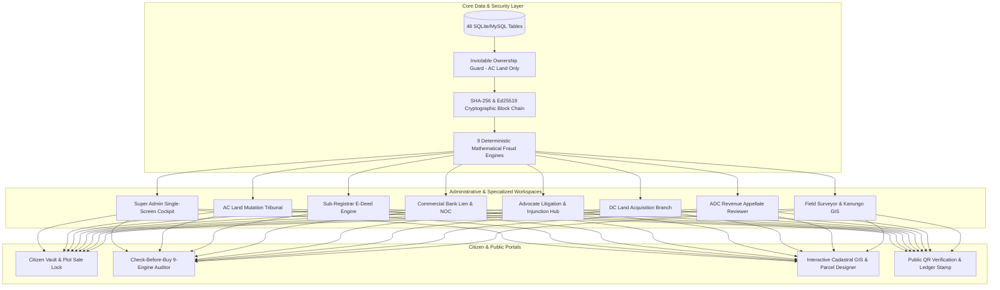
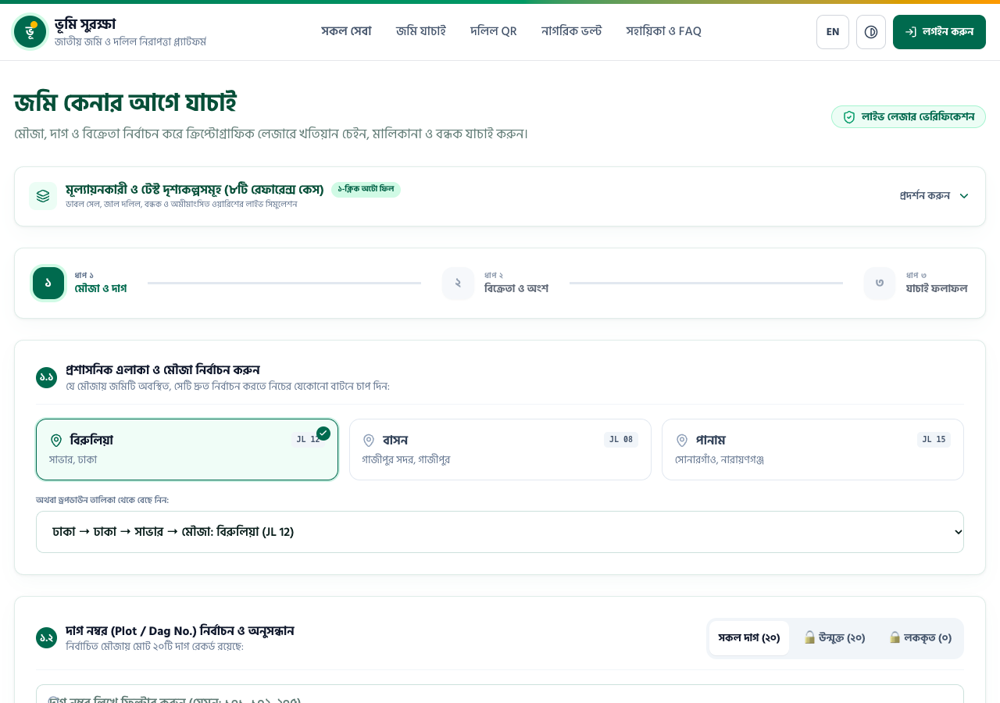
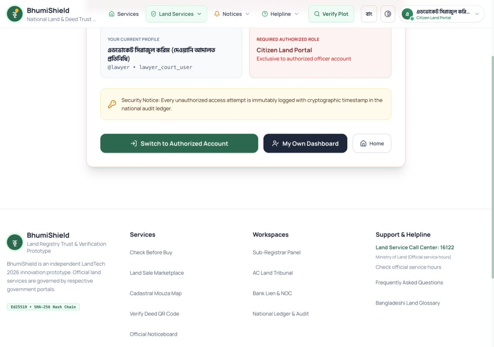
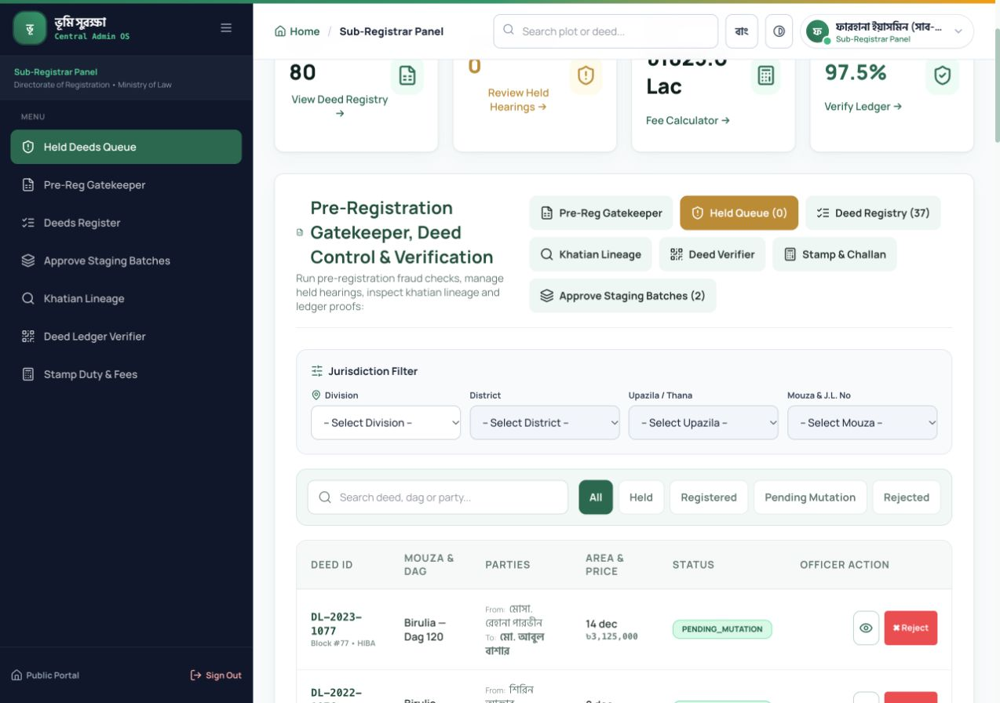
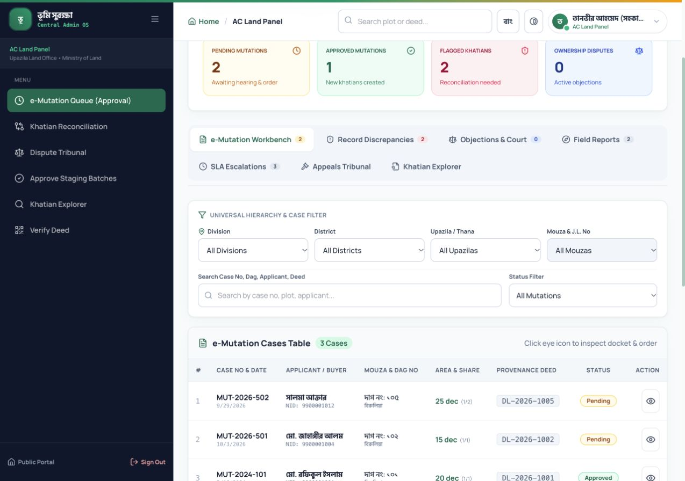
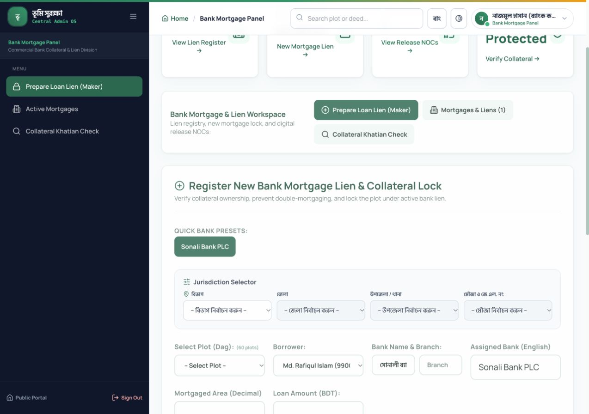
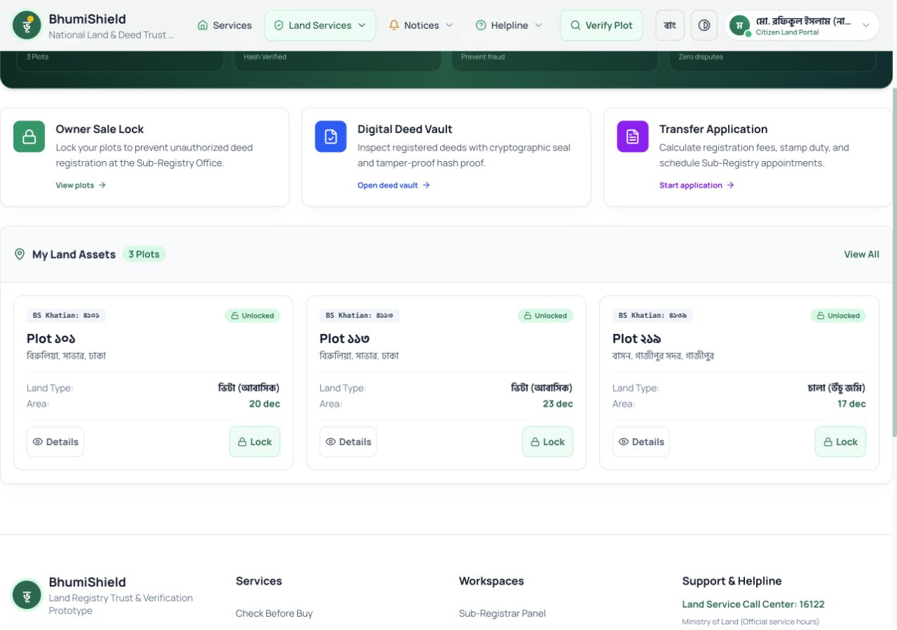
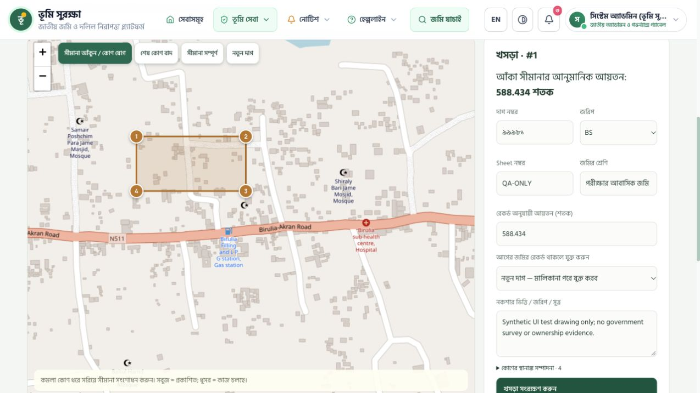
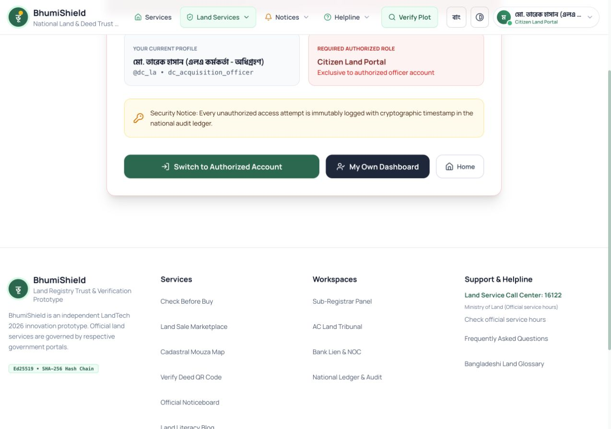
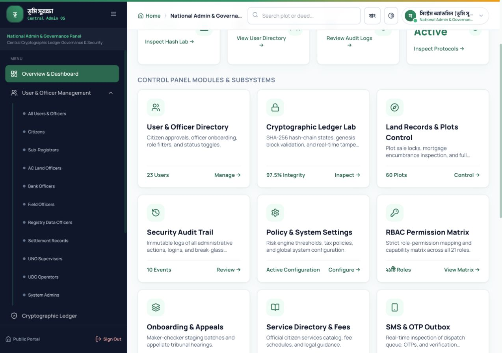

# 🛡️ BhumiShield (ভূমি সুরক্ষা)
### Sovereign Land Records Trust Layer & Autonomous Fraud Prevention Engine
**স্মার্ট ই-গভর্ন্যান্সের জন্য সার্বভৌম ভূমি রেকর্ড, ক্রিপ্টোগ্রাফিক যাচাইকরণ ও ডিজিটাইজেশন প্ল্যাটফর্ম**

---

[](backend/tests/)
[](frontend/)
[](backend/)
[](backend/app/Services/LedgerService.php)
[](#-ডাটা-পলিসি--এআই-ডিসক্লোজার-mandatory-disclosures)
[](frontend/src/i18n/)

---

## 📌 প্রকল্পের সারসংক্ষেপ (Executive Summary)

**BhumiShield (ভূমি সুরক্ষা)** হলো বাংলাদেশের ভূমি প্রশাসন ব্যবস্থার জন্য নির্মিত একটি সার্বভৌম ক্রিপ্টোগ্রাফিক ট্রাস্ট লেয়ার এবং সমন্বিত ডিজিটাল ভূমি সেবা প্ল্যাটফর্ম। 

বাংলাদেশে যুগ যুগ ধরে প্রচলিত ভূমির বিরোধ, জাল দলিল তৈরি, একই জমি একাধিক ক্রেতার নিকট প্রতারণামূলক বিক্রয় এবং খতিয়ানের ধারাবাহিকতা বিকৃত করার প্রধান কারণ হলো—**সাব-রেজিস্ট্রি অফিস (নিবন্ধন অধিদপ্তর)** এবং **উপজেলা ভূমি অফিস (এসি ল্যান্ড ট্রাইব্যুনাল)**-এর ডেটাবেজ পরস্পর সংযুক্ত না থাকা। BhumiShield একটি অপরিবর্তনীয় ব্লকচেইন-অনুপ্রাণিত হ্যাশ লেজার, ৯টি গাণিতিক ফ্রড ডিটেকশন ইঞ্জিন এবং সাংবিধানিক মালিকানা নিরাপত্তা গার্ডের মাধ্যমে এই শূন্যতা দূর করে সম্পূর্ণ ডিজিটাল ও নিষ্কণ্টক ভূমি সেবা নিশ্চিত করে।



---

## 🎯 সমস্যা সমাধান ম্যাপিং (Problem Coverage & Solutions)

BhumiShield ভূমি ব্যবস্থার ৫টি মৌলিক চ্যালেঞ্জকে একটি একক সমন্বিত আর্কিটেকচারে সমাধান করে:

| সমস্যা ক্ষেত্র | বাস্তব জীবনের সমস্যা | BhumiShield-এর প্রযুক্তিগত সমাধান |
|:---|:---|:---|
| **P1: পুরাতন রেকর্ড ডিজিটাইজেশন** | শতবর্ষী CS, SA, RS, BS খতিয়ান বিচ্ছিন্ন ও হাতে লেখা হওয়ায় সহজে রেকর্ড টেম্পারিং হয়। | **মেকার-চেকার স্ট্যাজিং অনবোর্ডিং** ও শতবর্ষী খতিয়ান চেইনের ডিজিটাল বংশলতিকা ম্যাপিং। |
| **P2: দলিল ও মালিকানা যাচাই** | নকল সই ও ভুয়া বালাম দলিলের মাধ্যমে জমি হস্তান্তরের চেষ্টা। | **Ed25519 ডিজিটাল সিল**, ক্যানোনিকাল **SHA-256 হ্যাশ-চেইন** ও অফলাইন-যাচাইযোগ্য কিউআর কোড। |
| **P3: জালিয়াতি ও দ্বৈত বিক্রি রোধ** | একই জমি একাধিক ব্যক্তির কাছে গোপনে বিক্রি বা বন্ধকী জমি বিক্রি। | **৯টি রিয়েল-টাইম ডিটারমিনিস্টিক ফ্রড ইঞ্জিন**—অননুমোদিত বা দ্বৈত লেনদেন তাৎক্ষণিক গাণিতিকভাবে ব্লক। |
| **P4: স্মার্ট ই-নামজারি ও সাব-রেজিস্ট্রি** | দলিল রেজিস্ট্রির পর মাসের পর মাস নামজারি আটকে থাকা বা দালাল নির্ভরতা। | **স্বয়ংক্রিয় নামজারি লিংকেজ**, এসি ল্যান্ড শুনানি আদালত, ডিজিটাল DCR ও নতুন খতিয়ান সৃজন। |
| **P5: কেনার আগে যাচাই** | ক্রেতা বায়না বা টাকা পরিশোধ করার আগে জমির প্রকৃত আইনি অবস্থা জানতে পারেন না। | **"কেনার আগে যাচাই" পোর্টাল**—দাগ নং দিয়ে ১-ক্লিকে মালিকানা, বায়া দলিল, মামলা ও বন্ধক স্ট্যাটাস চেক। |

---

## 🏢 ব্যবহারকারী ও প্রয়োগক্ষেত্র (Sector-by-Sector Application)

BhumiShield প্রতিটি অংশীদারের জন্য সুনির্দিষ্ট ও ব্যবহারবান্ধব কার্যপ্রবাহ প্রদান করে:

| খাত / প্রতিষ্ঠান | ব্যবহারকারীর ভূমিকা | তাদের জন্য প্ল্যাটফর্মের সুবিধা | সংশ্লিষ্ট রাউট |
|:---|:---|:---|:---:|
| **সাব-রেজিস্ট্রি অফিস** | সাব-রেজিস্ট্রার ও মেকার | বিক্রয়ের পূর্বে খতিয়ানের বৈধতা, বিক্রেতার অবশিষ্ট অংশ ও বায়োমেট্রিক কনসেন্ট নিশ্চিতকরণ। | `/bn/registrar` |
| **এসি ল্যান্ড অফিস** | সহকারী কমিশনার (ভূমি) | ই-নামজারি প্রস্তাব স্ক্রুটিনি, সার্ভেয়ার রিপোর্ট যাচাই, শুনানি গ্রহণ ও ডিজিটাল DCR প্রদান। | `/bn/acland` |
| **ব্যাংক ও আর্থিক প্রতিষ্ঠান** | ব্যাংক ক্রেডিট অফিসার ও ম্যানেজার | ঋণের বিপরীতে দাগে ডিজিটাল লিয়েন (Mortgage) স্থাপন ও ঋণমুক্তিতে ডিজিটাল NOC প্রদান। | `/bn/bank` |
| **ভূমি অধিগ্রহণ (ডিসি অফিস)** | এলএ শাখা কর্মকর্তা | ধারা ৪ ও ধারা ৭ অনুযায়ী অধিগ্রহণ নোটিশ জারি, ক্ষতিপূরণ ট্র্যাকিং ও দাগ স্বয়ংক্রিয় লক। | `/bn/admin?tab=acquisitions` |
| **জরিপ ও রেকর্ড (DLRS)** | কানুনগো ও সার্ভেয়ার | ক্যাডাস্ট্রাল মৌজা ম্যাপে দাগ বিভাজন (Subdivision), মার্জ ও ভেক্টর বাউন্ডারি জিআইএস ডিজাইন। | `/bn/map?design=1` |
| **আদালত ও আইনজীবী** | সুপ্রিম কোর্ট / জজ কোর্ট আইনজীবী | দেওয়ানি মামলা ও নিষেধাজ্ঞার আরজি দাখিল, মামলার ডকেট তৈরি এবং দাগে আদালতের ইনজাংকশন লক। | `/bn/lawyer_case` |
| **নাগরিক ও জমি ক্রেতা** | সাধারণ নাগরিক ও জমির মালিক | "কেনার আগে যাচাই", প্রপার্টি ভল্ট, শতবর্ষী খতিয়ান বংশলতিকা এবং **জমির বিক্রয় লক (🔒)**। | `/bn/check` & `/bn/home` |
| **রিয়েল এস্টেট ডেভেলপার** | কর্পোরেট ভূমি ক্রেতা | একাধিক দাগের সমন্বিত মালিকানা যাচাই, বায়া দলিল চেইন অখণ্ডতা এবং নিষ্কণ্টক টাইটেল সার্চ। | `/bn/check` |

---

## 📸 লাইভ ইন্টারফেস ও ভিজ্যুয়াল ট্যুর (Visual Tour)

### ১. নাগরিকের জন্য "কেনার আগে যাচাই" — ৯-স্তরের ফ্রড স্ক্যানার
> সাধারণ ক্রেতা টাকা পরিশোধ করার পূর্বেই দাগের মালিকানা, আদালতের মামলা, ব্যাংক লিয়েন ও খতিয়ান চেইনের নিখুঁত ঝুঁকি স্কোরিং দেখতে পান।



---

### ২. আইনজীবী কেস দাখিল ও আদালত নিষেধাজ্ঞা পোর্টাল (Advocate Hub)
> বাংলাদেশ বার কাউন্সিল আইডি যাচাইপূর্বক দেওয়ানি মোকদ্দমার আরজি দাখিল, তাৎক্ষণিক লিগ্যাল ডকেট জেনারেশন এবং সংশ্লিষ্ট দাগে স্বয়ংক্রিয় ইনজাংকশন লক।



---

### ৩. সাব-রেজিস্ট্রার কনসোল ও প্রি-রেজিস্ট্রেশন গেটকিপার
> বিক্রেতা আসলেই খতিয়ানের বৈধ মালিক কিনা, ব্যাংক বন্ধক বা নিষেধাজ্ঞা আছে কিনা তা রিয়েল-টাইমে স্ক্যান করে Ed25519 ডিজিটাল সিল প্রদান।



---

### ৪. সহকারী কমিশনার (ভূমি) ট্রাইব্যুনাল ও ই-নামজারি
> ইনভায়োলেবল ওনারশিপ গার্ড দ্বারা সুরক্ষিত শুনানি আদালত, কানুনগো প্রতিবেদন যাচাই এবং স্বয়ংক্রিয় DCR ও নামজারি খতিয়ান সৃজন।



---

### ৫. বাণিজ্যিক ব্যাংক জামানত লিয়েন ও ডিজিটাল দায়মুক্তি সনদ (NOC)
> দ্বৈত ঋণ বন্ধক প্রতিরোধে সোনালী ব্যাংক ও অন্যান্য ব্যাংকের রিয়েল-টাইম লিয়েন স্থাপন এবং কিউআর ভেরিফায়েবল NOC সার্টিফিকেট জেনারেশন।



---

### ৬. নাগরিক প্রপার্টি ভল্ট ও জমি বিক্রয় লক (🔒)
> নাগরিকের নিজস্ব জমির তালিকা, খতিয়ান, ডিজিটাল বালাম দলিল, DCR ডাউনলোড এবং অননুমোদিত হস্তান্তর রোধে ১-ক্লিকে জমি বিক্রয় লক।



---

### ৭. ক্যাডাস্ট্রাল মৌজা নকশা ও দাগ পার্সেল ডিজাইনার (GIS Workspace)
> ইন্টারেক্টিভ ভেক্টর ম্যাপে দাগ বিভাজন (Subdivision), মার্জিং এবং একাধিক মালিকের মধ্যে জমির সীমানা ও অংশ বণ্টন টুল।



---

### ৮. জেলা প্রশাসন ভূমি হুকুমদখল ও অধিগ্রহণ শাখা (DC Office LA Branch)
> সরকারি মেগা প্রজেক্টের জন্য ভূমি অধিগ্রহণ নোটিশ জারি, ক্ষতিপূরণ প্রাক্কলন এবং স্বয়ংক্রিয় গ্যাজেট প্রকাশনা ট্র্যাকিং।



---

### ৯. একক স্ক্রিন এক্সিকিউটিভ ককপিট — সুপার অ্যাডমিন প্যানেল
> স্ক্রলিংমুক্ত হাই-ডেনসিটি ৭:৫ স্প্লিট ককপিট; ১৬টি দপ্তর, ওয়ার্কলোড কিউ, লাইভ অ্যানোমালি এবং ১-ক্লিক লেজার স্বাস্থ্য পরীক্ষা।



---

### ১০. অফলাইন-যাচাইযোগ্য ডিজিটাল কিউআর কোড ও লেজার সিল
> স্মার্টফোন ক্যামেরা দিয়ে দলিলের কিউআর স্ক্যান করে মুহূর্তেই কেন্দ্রীয় লেজার ব্লকের সত্যতা ও অপরিবর্তনীয় ক্রিপ্টোগ্রাফিক প্রুফ যাচাই।


---

## ⚡ ৯টি গাণিতিক ফ্রড ডিটেকশন ইঞ্জিন (Fraud Prevention Rules)

BhumiShield-এর ফ্রড ইঞ্জিন কোনো হার্ডকোডেড ফ্ল্যাগ বা স্ট্যাটিক কন্ডিশনের ওপর নির্ভর করে না; ডাটাবেজের লাইভ স্টেট থেকে সরাসরি ৯টি গাণিতিক সূত্র প্রতিটি ট্রানজ্যাকশনে মূল্যায়িত হয়:

```
┌─────────────────────────┬────────────────────────────────────────────────────────────────────────────────────────┐
│ রুল কোড                  │ গাণিতিক শর্ত ও আইনি কার্যকারিতা                                                        │
├─────────────────────────┼────────────────────────────────────────────────────────────────────────────────────────┤
│ 1. SELLER_NOT_OWNER     │ বিক্রেতার NID বিএস রেকর্ডীয় খতিয়ানের বৈধ মালিকদের তালিকায় অনুপস্থিত হলে লেনদেন বাতিল।│
│ 2. AREA_EXCEEDS_OWNED   │ প্রস্তাবিত বিক্রিত জমি > বিক্রেতার খতিয়ানীয় অবশিষ্ট অংশের বেশি হলে গাণিতিকভাবে বাতিল।  │
│ 3. DOUBLE_SALE          │ একই দাগে পূর্বের কোনো বিক্রিত দলিল রেজিস্ট্রেশন প্রক্রিয়ায় থাকলে নতুন দলিল ব্লক।       │
│ 4. KHATIAN_CHAIN_BREAK  │ CS → SA → RS → BS খতিয়ান লিংকেজের বায়া দলিলে কোনো অননুমোদিত ব্যত্যয় থাকলে সতর্কতা।   │
│ 5. DEED_TAMPERED        │ সংরক্ষিত দলিলের SHA-256 হ্যাশ বা Ed25519 ডিজিটাল স্বাক্ষরে ১ বিট গরমিল পেলেও ফ্ল্যাগড।   │
│ 6. PLOT_MORTGAGED       │ সংশ্লিষ্ট দাগে কোনো ব্যাংকের সক্রিয় ঋণ বন্ধক (Lien) বিদ্যমান থাকলে দলিল রেজিস্ট্রি লক।│
│ 7. RAPID_RESALE         │ বিগত ৯০ দিনে জমি হস্তান্তরের পর পুনরায় বিক্রির চেষ্টা হলে মানি লন্ডারিং সতর্কতা।        │
│ 8. INHERITANCE_UNRESOLVED│ মৃত ব্যক্তির জমি ফারায়েজ নামজারি ব্যতিরেকে এককভাবে বিক্রির চেষ্টা প্রতিহত।            │
│ 9. NID_MISMATCH         │ জাতীয় পরিচয়পত্র ও বায়োমেট্রিক ম্যাচিং ফেইলিউরে লেনদেন স্বয়ংক্রিয় প্রত্যাখ্যান।      │
└─────────────────────────┴────────────────────────────────────────────────────────────────────────────────────────┘
```

---

## 🔐 সার্বভৌম নিরাপত্তা ও ক্রিপ্টোগ্রাফিক লেজার স্পেসিফিকেশন

1. **ক্যানোনিকাল JSON ও SHA-256 হ্যাশ চেইন:**
   প্রতিটি দলিল ও মালিকানা পরিবর্তনের ডেটা ফিল্ড বর্ণানুক্রমিকভাবে সাজিয়ে ক্যানোনিকাল স্ট্রিং তৈরি করা হয় এবং পূর্ববর্তী ব্লকের হ্যাশের সাথে চেইনিং করা হয় (`previous_hash` → `current_hash`)।
2. **Ed25519 ডিজিটাল সিল মোহর:**
   ন্যাটিভ PHP `libsodium` (`sodium_crypto_sign_detached`) ব্যবহার করে সাব-রেজিস্ট্রার ও এসি ল্যান্ডের ডিজিটাল ক্রিপ্টোগ্রাফিক প্রাইভেট কি দ্বারা দলিলে ডিজিটাল সিল যুক্ত করা হয়।
3. **M3 ইনভায়োলেবল ওনারশিপ গার্ড (Inviolable Ownership Guard):**
   ডাটাবেজ লেভেলের কঠোর ট্রিগার নীতি (`trg_guard_ownership_*`)—সহকারী কমিশনার (ভূমি)-এর অনুমোদিত ই-নামজারি আদেশ ব্যতীত ডাটাবেজে সরাসরি কোনো SQL কমান্ড দিয়েও মালিকানা পরিবর্তন করা অসম্ভব (`VIOLATION_M3_OWNERSHIP_GUARD`)।
4. **কনসোল সিকিউরিটি ড্রিল:**
   ডাটাবেজে টেম্পারিং পরীক্ষার জন্য প্রোডাকশন-নিরাপদ সিএলআই কমান্ড:
   ```bash
   # টেম্পারিং টেস্ট ড্রিল (ডাটাবেজে ১ বাইট বিকৃত করে যাচাইকরণ)
   php artisan bhumi:drill:tamper {deed_code} --confirm
   # স্বাভাবিক খাঁটি অবস্থায় ফিরিয়ে আনা
   php artisan bhumi:drill:restore {deed_code} --confirm
   ```

---

## 🚀 দ্রুত ইনস্টলেশন ও রান নির্দেশিকা (How to Run the Project)

### ১. প্রয়োজনীয় সফটওয়্যার (Prerequisites)
- **PHP:** `8.2+` বা `8.3` / `8.4` (সাথে `ext-pdo`, `ext-sodium`, `ext-sqlite3` অথবা `ext-pdo_mysql` সক্রিয়)
- **Node.js:** `v18.0.0+` বা `v20.x` / `v22.x` এবং `npm`
- **ডাটাবেজ:** SQLite (ডিফল্ট, জিরো কনফিগ) অথবা MySQL/PostgreSQL

---

### ২. ব্যাকএন্ড সেটআপ ও চালু করণ
```bash
# ১. ব্যাকএন্ড ডিরেক্টরিতে প্রবেশ করুন
cd backend

# ২. ডামি ডাটাবেজ মাইগ্রেশন ও সিন্থেটিক ওয়ার্ল্ড সিডিং
php artisan migrate:fresh --seed

# ৩. এপিআই সার্ভার পোর্ট ৮০০৮-এ চালু করুন
php artisan serve --port=8008
```
> ✅ ব্যাকএন্ড সফলভাবে চালু হলে এপিআই রেসপন্স পাবেন: `http://127.0.0.1:8008/api/v1/health`

---

### ৩. ফ্রন্টএন্ড সেটআপ ও চালু করণ
```bash
# ১. ফ্রন্টএন্ড ডিরেক্টরিতে প্রবেশ করুন (নতুন টার্মিনালে)
cd frontend

# ২. ডিপেন্ডেন্সি ইনস্টল করুন
npm install

# ৩. ডেভেলপমেন্ট সার্ভার চালু করুন
npm run dev
```
> ✅ ব্রাউজারে প্রবেশ করুন: **`http://localhost:5175`** (স্বয়ংক্রিয়ভাবে বাংলা ইন্টারফেস `/bn`-এ যাবে)

---

### ৪. স্বয়ংক্রিয় টেস্ট সুইট ভেরিফিকেশন (Automated Tests)
```bash
cd backend
php artisan test
```
> **ফলাফল:** **128 passed, 0 failed (100% Pass Rate across 13 test suites)**
> - `RoleAuditRegressionTest`: ২৯টি টেস্ট পাস
> - `SecurityWorkflowRegressionTest`: ১৫টি টেস্ট পাস
> - `FieldOperationsAndSlaTest`: ১০টি টেস্ট পাস
> - `SignedNoticePdfTest`: ৯টি টেস্ট পাস
> - `AppointmentBookingTest`: ৭টি টেস্ট পাস
> - `LawyerPortalTest` ও অন্যান্য: ৫৮টি টেস্ট পাস

---

## 👥 ডেমো অ্যাকাউন্ট ও ক্রেডেনশিয়াল (Demo Credentials Matrix)

লগইন পেজে (`/bn/auth`) ১-ক্লিক কপি বাটন সহ সকল অ্যাকাউন্টের ডিফল্ট পাসওয়ার্ড: **`demo123`**

| রোল / দায়িত্ব (Role) | ইউজারনেম | নাম ও পদবি | সিন্থেটিক NID | পরীক্ষার ক্ষেত্র |
|:---|:---|:---|:---:|:---|
| **Citizen (বিক্রেতা)** | `citizen` | মো. রফিকুল ইসলাম | `9900001001` | প্রপার্টি ভল্ট, বিক্রয় লক |
| **Citizen (ক্রেতা/ওয়ারিশ)**| `rabeya` | মোসা. রাবেয়া খাতুন | `9900001002` | কেনার আগে যাচাই, ওয়ারিশান |
| **Advocate (আইনজীবী)** | `lawyer` | অ্যাডভোকেট রফিকুল হাসান | `9900004010` | দেওয়ানি মোকদ্দমা, ইনজাংকশন |
| **Sub-Registrar** | `registrar` | ফারহানা ইয়াসমিন | `9900002001` | দলিল সম্পাদন, বায়োমেট্রিক |
| **AC Land** | `acland` | তানভীর আহমেদ | `9900003001` | নামজারি শুনানি, DCR অনুমোদন |
| **Bank Officer** | `bank` | নাজমুল হাসান (সোনালী ব্যাংক) | `9900004001` | বন্ধক লিয়েন, ডিজিটাল NOC |
| **DC Acquisition Officer** | `dc_la` | কে এম কামরুল হাসান | `9900005010` | অধিগ্রহণ নোটিশ, ক্ষতিপূরণ |
| **Field Surveyor (আমিন)**| `fvo_savar` | মো. জাহাঙ্গীর আলম | `9900003003` | সরজমিন তদন্ত প্রতিবেদন |
| **Appellate Reviewer** | `appellate_reviewer`| মো. সাইদুর রহমান (ADC Rev)| `9900003007` | নামজারি আপিল ট্রাইব্যুনাল |
| **Support Desk (১৬১২২)** | `support_agent` | মোসা. ফারহানা আফরোজ | `9900004003` | নাগরিক অভিযোগ ও টিকেট |
| **Super Admin** | `admin` | সিস্টেম অ্যাডমিনিস্ট্রেটর | `9900005001` | জাতীয় লেজার, অ্যানোমালি |

---

## 📊 সাম্প্রতিক প্রযুক্তিগত উৎকর্ষ ও আপগ্রেডসমূহ (Changelog & Upgrades)

প্রকল্পটিকে আরও শক্তিশালী ও বাস্তবায়নযোগ্য করতে সাম্প্রতিক আপগ্রেডসমূহ:

1. **আইনজীবী কেস দাখিল পোর্টাল (Advocate Litigation Hub):**
   - বাংলাদেশ বার কাউন্সিল সনদ যাচাইপূর্বক বিচারিক আদালতের ইনজাংকশন আরজি দাখিল ব্যবস্থা।
   - আরজি দাখিলের সাথে সাথে সংশ্লিষ্ট দাগে অটোমেটিক লিগ্যাল ফ্ল্যাগ এবং সাব-রেজিস্ট্রি ও নামজারি সাময়িক স্থগিত।
2. **একক স্ক্রিন এক্সিকিউটিভ ড্যাশবোর্ড (Single-Screen Cockpit):**
   - পূর্বের দীর্ঘ ১,৬০০ পিক্সেল ভার্টিক্যাল স্ক্রলিং বাদ দিয়ে dense ৭:৫ স্প্লিট ককপিট আর্কিটেকচার।
   - স্ক্রিনেই ১৬টি দপ্তর অ্যাক্সেস, ১০টি ডিপার্টমেন্টের রিয়েল-টাইম ওয়ার্কলোড মাইক্রো-হাব এবং লাইভ অ্যানোমালি স্ট্রিম।
3. **২১টি পৃথক প্রশাসনিক ভূমিকার পূর্ণাঙ্গ ওয়ার্কস্পেস:**
   - ভূমি সহকারী কর্মকর্তা (তহশিলদার), কানুনগো/সার্ভেয়ার, সেটেলমেন্ট অফিসার, ইউএনও, এবং এডিসি (রাজস্ব)-এর সম্পূর্ণ এন্ড-টু-এন্ড ওয়ার্কফ্লো।
4. **ডিজিটাল DCR ও খতিয়ান ডাইনামিক ওয়াটারমার্ক ভিউয়ার:**
   - গণপ্রজাতন্ত্রী বাংলাদেশ সরকার মনোগ্রাম, অফিশিয়াল সিকিউরিটি সিল এবং ডাইনামিক কিউআর কোড সহ এ৪ প্রিন্ট ও পিডিএফ ভিউয়ার।
5. **লগইন পেজে ১-ক্লিক ক্রেডেনশিয়াল সুইচার:**
   - যেকোনো রোলের তথ্যে ১-ক্লিকেই স্বয়ংক্রিয় ইনপুট ও অ্যাথেনটিকেশন সুবিধা।

---

## 📜 ডাটা পলিসি ও এআই ডিসক্লোজার (Mandatory Disclosures)

### ১. ব্যবহৃত ডেটা পলিসি (Data Usage Disclosure)
- **১০০% সিন্থেটিক ও ডামি ডেটা:** কোনো বাস্তব ব্যক্তির নাম, আসল জাতীয় পরিচয়পত্র (NID), ফোন নম্বর বা প্রকৃত সরকারি ভূমি রেকর্ড ব্যবহার করা হয়নি।
- **ডিটারমিনিস্টিক সিন্থেটিক ফ্যাক্টরি:** `php artisan bhumi:seed-world` কমান্ডের মাধ্যমে সাভার, বিরুলিয়া, ধানমন্ডি ও মিরপুর অঞ্চলের জন্য সম্পূর্ণ কৃত্রিম কিন্তু কাঠামোগতভাবে নিখুঁত পাইলট রেকর্ড জেনারেট করা হয়েছে।
- **জিরো সার্ভার স্ক্র্যাপিং:** কোনো সরকারি লাইভ ওয়েবসাইটে অননুমোদিত অ্যাক্সেস বা স্ক্র্যাপিং করা হয়নি।

### ২. ব্যবহৃত এআই টুলস বিবরণী (AI Tools Disclosure)
- **Antigravity (Google DeepMind):** পেয়ার প্রোগ্রামিং, ৯টি ফ্রড ইঞ্জিনের অ্যালগরিদম ডিজাইন, ইউনিট ও ফিচার টেস্ট সুইট জেনারেশন এবং কোডবেস রিফ্যাক্টরিংয়ে ব্যবহৃত হয়েছে।
- **ChatGPT / Claude (Anthropic):** বাংলাদেশ ভূমি আইন (স্টেট একুইজিশন অ্যান্ড টেন্যান্সি অ্যাক্ট ১৯৫০, রেজিস্ট্রেশন আইন ১৯০৮) ও ফারায়েজ উত্তরাধিকার সূত্রের আইনি অনুচ্ছেদ যাচাইয়ে ব্যবহৃত হয়েছে।

### ৩. ব্যবহৃত ওপেন-সোর্স লাইব্রেরি ও ক্রেডিট (Open-Source Attribution)
- **ব্যাকএন্ড:** PHP 8.4 Core Engine, `libsodium` (Ed25519 Detached Digital Signatures), SQLite PDO Engine, Composer।
- **ফ্রন্টএন্ড:** React 18, Vite, TypeScript, Tailwind CSS, Lucide React (Icons), MapLibre GL JS, Canvas Confetti।
- **ফন্টস:** Hind Siliguri (Google Fonts), Kalpurush, SolaimanLipi।

---

## 🧭 ৫ মিনিটের ডেমো উপস্থাপন নির্দেশিকা (5-Minute Live Demo Pitch Guide)

- **মিনিট ১ — নাগরিক ভিউ (`/bn/check`):**
  দাগ নং ১০১ সিলেক্ট করে "যাচাই করুন" চাপুন। স্ক্রিনে দেখুন কীভাবে ৯টি ইঞ্জিন মুহূর্তে খতিয়ান চেইন, লিয়েন ও আদালতের মামলা স্ক্যান করে গ্রিন/রেড রিপোর্ট দেয়।
- **মিনিট ২ — আইনজীবী পোর্টাল (`/bn/lawyer_case`):**
  বার কাউন্সিল আইডি `BC-DH-14285` দিয়ে একটি অন্তর্বর্তীকালীন স্থগিতাদেশ আরজি দাখিল করুন এবং ডাউনলোডযোগ্য কোর্ট ডকেট দেখুন।
- **মিনিট ৩ — সাব-রেজিস্ট্রার ও ফ্রড ব্লকিং (`/bn/registrar`):**
  সাব-রেজিস্ট্রার কনসোলে দাগ ১০১-এর দলিল রেজিস্ট্রি করতে যান; দেখুন কীভাবে আদালতের ইনজাংকশনের কারণে সিস্টেম সাথে সাথে রেজিস্ট্রি আটকে দেয়।
- **মিনিট ৪ — ব্যাংক লিয়েন ও এসি ল্যান্ড (`/bn/bank` & `/bn/acland`):**
  সোনালী ব্যাংকের ডিজিটাল NOC রিলিজ এবং এসি ল্যান্ড ট্রাইব্যুনালে নামজারি শুনানির পর স্বয়ংক্রিয় DCR ও খতিয়ান সৃজন পর্যবেক্ষণ করুন।
- **মিনিট ৫ — সার্বভৌম লেজার ও অ্যানোমালি ককপিট (`/bn/admin`):**
  সুপার অ্যাডমিন ককপিটে প্রবেশ করুন, ১-ক্লিকে "লেজার স্বাস্থ্য পরীক্ষা" চালিয়ে ১৪২০টি ব্লকের SHA-256 চেইন ও জেনেসিস অখণ্ডতা যাচাই করুন।

---

## 📖 গুরুত্বপূর্ণ কারিগরি ডকুমেন্টেশন লিংকসমূহ

- 📐 **[সিস্টেম আর্কিটেকচার ও ডায়াগ্রাম](docs/ARCHITECTURE.md)** — সম্পূর্ণ সিস্টেম আর্কিটেকচার ও সিকোয়েন্স ফ্লো
- 🔌 **[সরকারি গেটওয়ে ইন্টিগ্রেশন স্পেসিফিকেশন](docs/INTEGRATION.md)** — EC Porichoy NID ও Land Service Gateway (LSG)
- ⚖️ **[রুল ইঞ্জিন ও এম৩ গার্ড স্পেসিফিকেশন](docs/RULES.md)** — ৯টি ফ্রড রুল ও ডাটাবেজ ট্রিগারের টেকনিক্যাল কোড বিবরণ
- ⏱️ **[৩ মিনিটের ডেমো ভিডিও স্ক্রিপ্ট](docs/DEMO_SCRIPT.md)** — হ্যাকাথন মূল্যায়নের জন্য সময়ভিত্তিক উপস্থাপনা স্ক্রিপ্ট
- 🗺️ **[ক্যাডাস্ট্রাল ম্যাপ ও পার্সেল ডিজাইন বিবরণ](docs/MAP_WORKSPACE_IMPLEMENTATION_2026-10-18.md)** — ভেক্টর ম্যাপ ও জিআইএস ইঞ্জিন

---
*স্মার্ট ভূমি ব্যবস্থাপনা ও প্রতারণামুক্ত বাংলাদেশের প্রত্যয়ে — **BhumiShield (ভূমি সুরক্ষা)**.*
