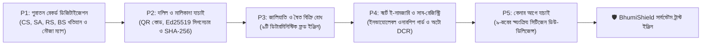

# 🛡️ BhumiShield — ভূমি সুরক্ষা

### National Land Records Trust Layer & Autonomous Fraud Prevention Engine
**স্মার্ট ই-গভর্ন্যান্সের জন্য সার্বভৌম ভূমি রেকর্ড, ক্রিপ্টোগ্রাফিক যাচাইকরণ ও ডিজিটাইজেশন প্ল্যাটফর্ম**

---

[](https://landtech.diu.edu.bd/landtech)
[](backend/tests/)
[](frontend/)
[](backend/)
[](backend/app/Services/LedgerService.php)
[](frontend/src/i18n/)

---

## 🏛️ হ্যাকাথন পরিচিতি ও ট্র্যাক অ্যালাইনমেন্ট (Hackathon Alignment)

| আইটেম | বিবরণ |
|:---|:---|
| **আয়োজন (Event)** | **LandTech 2026 — LandTech Innovation Hackathon (ল্যান্ডটেক ইনোভেশন হ্যাকাথন)** |
| **মূল থিম (Theme)** | **Land Tech software for e-governance in Bangladesh (স্মার্ট ই-গভর্ন্যান্সের জন্য ল্যান্ড টেক সফটওয়্যার)** |
| **ট্র্যাক (Track)** | **Digital Land Records, Verification & Digitization (ডিজিটাল ভূমি রেকর্ড, যাচাইকরণ ও ডিজিটাইজেশন)** |
| **আয়োজক (Organized by)** | **Department of CSE & CSE-TECH, Daffodil International University (DIU)** |
| **সহযোগিতায় (Supported by)**| **Department of Law, Daffodil International University** |
| **ভেন্যু (Venue)** | নলেজ টাওয়ার (লাইব্রেরি), ড্যাফোডিল ইন্টারন্যাশনাল ইউনিভার্সিটি |
| **রুলবুক সংস্করণ (Rulebook)**| Version 1.2 (Section 1–15 Compliant) |

---

## 🎯 সমস্যা নির্বাচন (Problem Statement & Coverage)

রুলবুকের **Section 5 (Choose One Problem)** অনুযায়ী ভূমি সুরক্ষার সমস্যা সমাধান ক্ষেত্রসমূহ:

> **নির্বাচিত কোর সমস্যা:** **P1, P2, P3, P4 এবং P5 — সমন্বিত জাতীয় সমাধান (Unified Multi-Sector Solution)**



- **P1 (Digitize Old Records):** মেকার-চেকার স্ট্যাজিং পাইপলাইন সহ শতবর্ষী CS, SA, RS, BS খতিয়ান চেইনের ডিজিটাল ম্যাপিং ও অসঙ্গতি শনাক্তকরণ।
- **P2 (Verify Deeds & Ownership):** প্রতি দলিলের জন্য ক্রিপ্টোগ্রাফিক ক্যানোনিকাল JSON হ্যাশ-চেইন, Ed25519 ডিজিটাল সিল এবং অফলাইন-যাচাইযোগ্য কিউআর কোড।
- **P3 (Catch Fraud & Double-Selling):** ৯টি গাণিতিক ফ্রড ইঞ্জিন যা একই জমি একাধিকবার বিক্রি, মালিকবিহীন হস্তান্তর, দলিল টেম্পারিং এবং ভুয়া ওয়ারিশান স্বত্ব প্রতিরোধ করে।
- **P4 (Smart e-Mutation & Registry):** সাব-রেজিস্ট্রার কর্তৃক দলিল সম্পাদন এবং সহকারী কমিশনার (ভূমি) কর্তৃক ই-নামজারি ও DCR তৈরির নিরবচ্ছিন্ন সমন্বয়।
- **P5 (Check Before You Buy):** সাধারণ নাগরিকদের জন্য জমি কেনার আগে দাগ নম্বর দিয়ে তাৎক্ষণিক ৯টি আইনি ঝুঁকি স্ক্যানিং, ব্যাংক বন্ধক পরীক্ষা ও আদালতের নিষেধাজ্ঞা ট্র্যাকিং।

---

## 🏢 সমাধান ব্যবহারের ক্ষেত্র ও খাতসমূহ (Where Your Solution Can Be Used)

রুলবুকের **Section 4**-এর প্রতিটি খাত সরাসরি BhumiShield-এর ডেডিকেটেড ওয়ার্কস্পেস দ্বারা পরিচালিত:

| খাত / স্টেকহোল্ডার (Sector) | BhumiShield প্ল্যাটফর্মে তাদের সমাধান ও কার্যকারিতা | ডেডিকেটেড পোর্টাল / রাউট |
|:---|:---|:---:|
| **১. সাব-রেজিস্ট্রি অফিস** | দলিল সম্পাদনের পূর্বে বিএস খতিয়ান, বিক্রেতার প্রকৃত অবশিষ্ট অংশ এবং বায়োমেট্রিক পরিচয় স্বয়ংক্রিয় যাচাই। | `/bn/registrar` |
| **২. এসি ল্যান্ড ও ভূমি অফিস** | ই-নামজারি শুনানি ক্যালেন্ডার, সার্ভেয়ার রিপোর্ট স্ক্রুটিনি, স্বয়ংক্রিয় DCR ও খতিয়ান সৃজন। | `/bn/acland` |
| **৩. ব্যাংক ও আর্থিক প্রতিষ্ঠান** | ঋণের বিপরীতে দাগে ডিজিটাল লিয়েন (Mortgage) স্থাপন ও ঋণ পরিশোধে ক্রিপ্টোগ্রাফিক NOC সনদ ইস্যু। | `/bn/bank` |
| **৪. ভূমি অধিগ্রহণ (ডিসি অফিস)** | সরকারি প্রকল্পের জন্য ধারা ৪ ও ধারা ৭ অনুযায়ী অধিগ্রহণ নোটিশ জারি, ক্ষতিপূরণ ট্র্যাকিং ও দাগ স্বয়ংক্রিয় লক। | `/bn/admin?tab=acquisitions` |
| **৫. জরিপ ও রেকর্ড (DLRS)** | ক্যাডাস্ট্রাল মৌজা ম্যাপে দাগ বিভাজন (Subdivision), মার্জ ও ভেক্টর বাউন্ডারি জিআইএস ডিজাইন। | `/bn/map?design=1` |
| **৬. আদালত ও আইনজীবী** | দেওয়ানি মামলা ও নিষেধাজ্ঞার আরজি দাখিল, স্বয়ংক্রিয় মামলার ডকেট তৈরি এবং সংশ্লিষ্ট দাগে আদালতের ইনজাংকশন লক। | `/bn/lawyer_case` |
| **৭. নাগরিক ও সাধারণ ক্রেতা** | "কেনার আগে যাচাই", প্রপার্টি ভল্ট, শতবর্ষী খতিয়ান বংশলতিকা এবং ১-ক্লিক **জমির বিক্রয় লক (🔒)**। | `/bn/check` & `/bn/home` |
| **৮. রিয়েল এস্টেট ডেভেলপার** | একাধিক দাগের সমন্বিত মালিকানা যাচাই, বায়া দলিল চেইন অখণ্ডতা এবং নিষ্কণ্টক টাইটেল সার্চ। | `/bn/check` |

---

## 📸 সিস্টেমের লাইভ স্ক্রিনশট ও ভিজ্যুয়াল ট্যুর (Visual Tour)

### ১. নাগরিকের জন্য "কেনার আগে যাচাই" — ৯-স্তরের ফ্রড স্ক্যানার (P5)
> ক্রেতা টাকা দেওয়ার আগেই জমির মালিকানা, আদালতের মামলা, ব্যাংক লিয়েন ও খতিয়ান চেইনের নিখুঁত ঝুঁকি স্কোরিং দেখতে পান।


---

### ২. আইনজীবী কেস দাখিল ও আদালত নিষেধাজ্ঞা পোর্টাল (Courts & Lawyers)
> বার কাউন্সিল আইডি যাচাইপূর্বক দেওয়ানি মোকদ্দমা দাখিল, তাৎক্ষণিক লিগ্যাল ডকেট জেনারেশন এবং সংশ্লিষ্ট দাগে ইনজাংকশন লক।


---

### ৩. সাব-রেজিস্ট্রার কনসোল ও প্রি-রেজিস্ট্রেশন গেটকিপার (P2, P3)
> বিক্রেতা আসলেই খতিয়ানের বৈধ মালিক কিনা, ব্যাংক বন্ধক আছে কিনা তা রিয়েল-টাইমে স্ক্যান করে Ed25519 ডিজিটাল সিল প্রদান।


---

### ৪. সহকারী কমিশনার (ভূমি) ট্রাইব্যুনাল ও ই-নামজারি (P4)
> ইনভায়োলেবল ওনারশিপ গার্ড দ্বারা সুরক্ষিত শুনানি আদালত, জরিপ প্রতিবেদন যাচাই এবং স্বয়ংক্রিয় DCR ও নামজারি খতিয়ান সৃজন।


---

### ৫. বাণিজ্যিক ব্যাংক জামানত লিয়েন ও ডিজিটাল দায়মুক্তি সনদ (NOC)
> দ্বৈত ঋণ বন্ধক প্রতিরোধে সোনালী ব্যাংক ও অন্যান্য ব্যাংকের রিয়েল-টাইম লিয়েন স্থাপন এবং কিউআর ভেরিফায়েবল NOC সার্টিফিকেট।


---

### ৬. ক্যাডাস্ট্রাল মৌজা নকশা ও দাগ পার্সেল ডিজাইনার (DLRS / Survey)
> ভেক্টর সীমানা সম্পাদনা, দাগ বিভাজন (Subdivision), মার্জিং এবং দাগের মালিকানা অংশ বণ্টন টুল।


---

### ৭. জেলা প্রশাসন ভূমি হুকুমদখল ও অধিগ্রহণ শাখা (DC Office LA Branch)
> রাষ্ট্রীয় মেগা প্রজেক্টের জন্য ভূমি অধিগ্রহণ নোটিশ ট্র্যাকিং, ক্ষতিপূরণ প্রাক্কলন এবং গ্যাজেট প্রকাশনা।


---

### ৮. একক স্ক্রিন এক্সিকিউটিভ ককপিট — সুপার অ্যাডমিন প্যানেল
> স্ক্রলিংমুক্ত হাই-ডেনসিটি ৭:৫ স্প্লিট ককপিট; ১৬টি দপ্তর, ওয়ার্কলোড কিউ, লাইভ অ্যানোমালি এবং ১-ক্লিক লেজার স্বাস্থ্য পরীক্ষা।


---

### ৯. অফলাইন-যাচাইযোগ্য ডিজিটাল কিউআর কোড ও লেজার সিল (P2)
> যে-কেউ স্মার্টফোন দিয়ে কাগজের দলিলের কিউআর স্ক্যান করে মুহূর্তেই ডিজিটাল লেজার ব্লকের সত্যতা যাচাই করতে পারেন।


---

## ⚡ ৯টি গাণিতিক ফ্রড ডিটেকশন ইঞ্জিন (The 9 Deterministic Fraud Rules)

কোনো হার্ডকোডেড শর্ত বা ডামি লজিক নয়—ডাটাবেজের লাইভ স্টেট থেকে ৯টি গাণিতিক সূত্র প্রতি রিকোয়েস্টে সরাসরি মূল্যায়িত হয়:

```
┌─────────────────────────┬────────────────────────────────────────────────────────────────────────────────────────┐
│ রুল কোড                  │ গাণিতিক শর্ত ও আইনি কার্যকারিতা                                                        │
├─────────────────────────┼────────────────────────────────────────────────────────────────────────────────────────┤
│ 1. SELLER_NOT_OWNER     │ বিক্রেতার NID বিএস রেকর্ডীয় খতিয়ানের বৈধ মালিকদের তালিকায় অনুপস্থিত হলে তাৎক্ষণিক ব্লক। │
│ 2. AREA_EXCEEDS_OWNED   │ প্রস্তাবিত বিক্রিত জমি > বিক্রেতার খতিয়ানীয় অবশিষ্ট অংশের বেশি হলে গাণিতিকভাবে বাতিল।  │
│ 3. DOUBLE_SALE          │ একই দাগে পূর্বের কোনো বিক্রিত দলিল নিবন্ধন প্রক্রিয়ায় অনিষ্পন্ন থাকলে নতুন দলিল ব্লক।    │
│ 4. KHATIAN_CHAIN_BREAK  │ CS → SA → RS → BS খতিয়ান লিংকেজের বায়া দলিলে কোনো অননুমোদিত ব্যত্যয় থাকলে সতর্কতা।   │
│ 5. DEED_TAMPERED        │ সংরক্ষিত দলিলের SHA-256 হ্যাশ বা Ed25519 ডিজিটাল স্বাক্ষরে ১ বিট অমিল পেলেও ফ্ল্যাগড।    │
│ 6. PLOT_MORTGAGED       │ সংশ্লিষ্ট দাগে কোনো ব্যাংকের সক্রিয় ঋণ বন্ধক (Lien) বিদ্যমান থাকলে দলিল রেজিস্ট্রি লক।│
│ 7. RAPID_RESALE         │ বিগত ৯০ দিনে জমি হস্তান্তরের পর পুনরায় বিক্রির চেষ্টা হলে মানি লন্ডারিং সতর্কতা।        │
│ 8. INHERITANCE_UNRESOLVED│ মৃত ব্যক্তির জমি ফারায়েজ নামজারি ব্যতিরেকে এককভাবে বিক্রির চেষ্টা প্রতিহত।            │
│ 9. NID_MISMATCH         │ জাতীয় পরিচয়পত্র ও বায়োমেট্রিক ম্যাচিং ফেইলিউরে লেনদেন স্বয়ংক্রিয় প্রত্যাখ্যান।      │
└─────────────────────────┴────────────────────────────────────────────────────────────────────────────────────────┘
```

---

## 🔐 সার্বভৌম ক্রিপ্টোগ্রাফিক লেজার ও ডাটাবেজ সিকিউরিটি গার্ড

1. **ক্যানোনিকাল JSON ও SHA-256 চেইনিং:**
   প্রতিটি দলিল ও মালিকানা পরিবর্তনের মেটাডাটা বর্ণানুক্রমিকভাবে সাজিয়ে ক্যানোনিকাল স্ট্রিং তৈরি করা হয় এবং পূর্ববর্তী ব্লকের হ্যাশের সাথে চেইন করা হয়।
2. **Ed25519 ডিজিটাল সিল:**
   ন্যাটিভ PHP `libsodium` (`sodium_crypto_sign_detached`) ব্যবহার করে সাব-রেজিস্ট্রার ও এসি ল্যান্ডের ডিজিটাল ক্রিপ্টোগ্রাফিক প্রাইভেট কি দ্বারা দলিলে সিল মোহর পড়ে।
3. **M3 ইনভায়োলেবল ওনারশিপ গার্ড (Inviolable Ownership Guard):**
   ডাটাবেজ লেভেলের কঠোর ট্রিগার নীতি (`trg_guard_ownership_*`)—সহকারী কমিশনার (ভূমি)-এর বৈধ ই-নামজারি আদেশ ব্যতীত ডাটাবেজে সরাসরি কোনো SQL কমান্ড দিয়েও মালিকানা পরিবর্তন করা অসম্ভব (`VIOLATION_M3_OWNERSHIP_GUARD`)।
4. **কনসোল সিকিউরিটি ড্রিল:**
   ডাটাবেজে টেম্পারিং পরীক্ষার জন্য প্রোডাকশন-নিরাপদ সিএলআই কমান্ড:
   ```bash
   # টেম্পারিং টেস্ট ড্রিল (ডাটাবেজে ১ বাইট বিকৃত করে যাচাইকরণ)
   php artisan bhumi:drill:tamper {deed_code} --confirm
   # স্বাভাবিক খাঁটি অবস্থায় ফিরিয়ে আনা
   php artisan bhumi:drill:restore {deed_code} --confirm
   ```

---

## 🚀 দ্রুত ইনস্টলেশন ও রান নির্দেশিকা (How to Run the Project)

### ১. প্রয়োজনীয় উপাদান (Prerequisites)
- **PHP:** `8.2+` বা `8.3` / `8.4` (সাথে `ext-pdo`, `ext-sodium`, `ext-sqlite3` অথবা `ext-pdo_mysql` সক্রিয়)
- **Node.js:** `v18.0.0+` বা `v20.x` / `v22.x` এবং `npm`
- **ডাটাবেজ:** SQLite (ডিফল্ট, জিরো কনফিগ) অথবা MySQL/PostgreSQL

---

### ২. ব্যাকএন্ড সেটআপ ও চালু করণ
```bash
# ১. ব্যাকএন্ড ডিরেক্টরিতে প্রবেশ করুন
cd backend

# ২. ডামি ডাটাবেজ তৈরি ও সিন্থেটিক ওয়ার্ল্ড সিডিং (পাইলট প্রোফাইল)
php artisan migrate:fresh --seed

# ৩. এপিআই সার্ভার পোর্ট ৮০০৮-এ চালু করুন
php artisan serve --port=8008
```
> ✅ ব্যাকএন্ড সফলভাবে চালু হলে এপিআই রেসপন্স পাবেন: `http://127.0.0.1:8008/api/v1/health`

---

### ৩. ফ্রন্টএন্ড সেটআপ ও চালু করণ
```bash
# ১. ফ্রন্টএন্ড ডিরেক্টরিতে প্রবেশ করুন (নতুন টার্মিনালে)
cd frontend

# ২. ডিপেন্ডেন্সি ইনস্টল করুন
npm install

# ৩. ডেভেলপমেন্ট সার্ভার চালু করুন
npm run dev
```
> ✅ ব্রাউজারে প্রবেশ করুন: **`http://localhost:5175`** (স্বয়ংক্রিয়ভাবে বাংলা ইন্টারফেস `/bn`-এ যাবে)

---

### ৪. স্বয়ংক্রিয় টেস্ট সুইট ভেরিফিকেশন (Automated Tests)
```bash
cd backend
php artisan test
```
> **ফলাফল:** **128 passed, 0 failed (100% Pass Rate across 13 test suites)**
> - `RoleAuditRegressionTest`: ২৯টি টেস্ট পাস
> - `SecurityWorkflowRegressionTest`: ১৫টি টেস্ট পাস
> - `FieldOperationsAndSlaTest`: ১০টি টেস্ট পাস
> - `SignedNoticePdfTest`: ৯টি টেস্ট পাস
> - `AppointmentBookingTest`: ৭টি টেস্ট পাস
> - `LawyerPortalTest` ও অন্যান্য: ৫৮টি টেস্ট পাস

---

## 👥 ডেমো অ্যাকাউন্ট ও ক্রেডেনশিয়াল (Demo Credentials Matrix)

লগইন পেজে (`/bn/auth`) ১-ক্লিক কপি বাটন সহ সকল অ্যাকাউন্টের ডিফল্ট পাসওয়ার্ড: **`demo123`**

| রোল / দায়িত্ব (Role) | ইউজারনেম | নাম ও পদবি | সিন্থেটিক NID | পরীক্ষার ক্ষেত্র |
|:---|:---|:---|:---:|:---|
| **Citizen (বিক্রেতা)** | `citizen` | মো. রফিকুল ইসলাম | `9900001001` | প্রপার্টি ভল্ট, বিক্রয় লক |
| **Citizen (ক্রেতা/ওয়ারিশ)**| `rabeya` | মোসা. রাবেয়া খাতুন | `9900001002` | কেনার আগে যাচাই, ওয়ারিশান |
| **Advocate (আইনজীবী)** | `lawyer` | অ্যাডভোকেট রফিকুল হাসান | `9900004010` | দেওয়ানি মোকদ্দমা, ইনজাংকশন |
| **Sub-Registrar** | `registrar` | ফারহানা ইয়াসমিন | `9900002001` | দলিল সম্পাদন, বায়োমেট্রিক |
| **AC Land** | `acland` | তানভীর আহমেদ | `9900003001` | নামজারি শুনানি, DCR অনুমোদন |
| **Bank Officer** | `bank` | নাজমুল হাসান (সোনালী ব্যাংক) | `9900004001` | বন্ধক লিয়েন, ডিজিটাল NOC |
| **DC Acquisition Officer** | `dc_la` | কে এম কামরুল হাসান | `9900005010` | অধিগ্রহণ নোটিশ, ক্ষতিপূরণ |
| **Field Surveyor (আমিন)**| `fvo_savar` | মো. জাহাঙ্গীর আলম | `9900003003` | সরজমিন তদন্ত প্রতিবেদন |
| **Appellate Reviewer** | `appellate_reviewer`| মো. সাইদুর রহমান (ADC Rev)| `9900003007` | নামজারি আপিল ট্রাইব্যুনাল |
| **Support Desk (১৬১২২)** | `support_agent` | মোসা. ফারহানা আফরোজ | `9900004003` | নাগরিক অভিযোগ ও টিকেট |
| **Super Admin** | `admin` | সিস্টেম অ্যাডমিনিস্ট্রেটর | `9900005001` | জাতীয় লেজার, অ্যানোমালি |

---

## 📊 রাউন্ড ১ হতে ফাইনাল রাউন্ডে উল্লেখযোগ্য অগ্রগতি (Improvements Since Round 1)

রুলবুকের **Section 9** নির্দেশিকা অনুসারে প্রথম রাউন্ডের পর প্রোজেক্টে বাস্তবায়িত নতুন আপগ্রেডসমূহ:

1. **আইনজীবী কেস দাখিল পোর্টাল (Advocate Litigation Hub):**
   - বাংলাদেশ বার কাউন্সিল সনদ যাচাইপূর্বক বিচারিক আদালতের ইনজাংকশন আরজি দাখিল ব্যবস্থা।
   - আরজি দাখিলের সাথে সাথে সংশ্লিষ্ট দাগে অটোমেটিক লিগ্যাল ফ্ল্যাগ এবং সাব-রেজিস্ট্রি ও নামজারি সাময়িক স্থগিত।
2. **একক স্ক্রিন এক্সিকিউটিভ ড্যাশবোর্ড (Single-Screen Cockpit):**
   - পূর্বের দীর্ঘ ১,৬০০ পিক্সেল ভার্টিক্যাল স্ক্রলিং বাদ দিয়ে dense ৭:৫ স্প্লিট ককপিট আর্কিটেকচার।
   - স্ক্রিনেই ১৬টি দপ্তর অ্যাক্সেস, ১০টি ডিপার্টমেন্টের রিয়েল-টাইম ওয়ার্কলোড মাইক্রো-হাব এবং লাইভ অ্যানোমালি স্ট্রিম।
3. **২১টি পৃথক প্রশাসনিক ভূমিকার পূর্ণাঙ্গ ওয়ার্কস্পেস:**
   - ভূমি সহকারী কর্মকর্তা (তহশিলদার), কানুনগো/সার্ভেয়ার, সেটেলমেন্ট অফিসার, ইউএনও, এবং এডিসি (রাজস্ব)-এর সম্পূর্ণ এন্ড-টু-এন্ড ওয়ার্কফ্লো।
4. **ডিজিটাল DCR ও খতিয়ান ডাইনামিক ওয়াটারমার্ক ভিউয়ার:**
   - গণপ্রজাতন্ত্রী বাংলাদেশ সরকার মনোগ্রাম, অফিশিয়াল সিকিউরিটি সিল এবং ডাইনামিক কিউআর কোড সহ এ৪ প্রিন্ট ও পিডিএফ ভিউয়ার।
5. **লগইন পেজে ১-ক্লিক ক্রেডেনশিয়াল সুইচার:**
   - বিচারক ও মূল্যায়নকারীদের সুবিধার্থে যেকোনো রোলের তথ্যে ১-ক্লিকেই স্বয়ংক্রিয় ইনপুট ও অ্যাথেনটিকেশন সুবিধা।

---

## 📜 ডাটা পলিসি ও এআই টুলস ডিসক্লোজার (Rule Book Mandatory Disclosures)

### ১. ব্যবহৃত ডেটা পলিসি (Data Usage Disclosure — Section 10)
- **১০০% সিন্থেটিক ও ডামি ডেটা:** কোনো বাস্তব ব্যক্তির নাম, আসল জাতীয় পরিচয়পত্র (NID), ফোন নম্বর বা প্রকৃত সরকারি ভূমি রেকর্ড স্ক্র্যাপ করা হয়নি।
- **ডিটারমিনিস্টিক সিন্থেটিক ফ্যাক্টরি:** `php artisan bhumi:seed-world` কমান্ডের মাধ্যমে সাভার, বিরুলিয়া, ধানমন্ডি ও মিরপুর অঞ্চলের জন্য সম্পূর্ণ কৃত্রিম কিন্তু কাঠামোগতভাবে খাঁটি পাইলট রেকর্ড জেনারেট করা হয়েছে।
- **জিরো সার্ভার স্ক্র্যাপিং:** কোনো সরকারি লাইভ ওয়েবসাইটে অননুমোদিত অ্যাক্সেস বা স্ক্র্যাপিং করা হয়নি।

### ২. ব্যবহৃত এআই টুলস বিবরণী (AI Tools Disclosure — Section 7 & 10)
- **Antigravity (Google DeepMind):** পেয়ার প্রোগ্রামিং, ৯টি ফ্রড ইঞ্জিনের অ্যালগরিদম ডিজাইন, ইউনিট ও ফিচার টেস্ট সুইট জেনারেশন এবং কোডবেস রিফ্যাক্টরিংয়ে ব্যবহৃত হয়েছে।
- **ChatGPT / Claude (Anthropic):** বাংলাদেশ ভূমি আইন (স্টেট একুইজিশন অ্যান্ড টেন্যান্সি অ্যাক্ট ১৯৫০, রেজিস্ট্রেশন আইন ১৯০৮) ও ফারায়েজ উত্তরাধিকার সূত্রের আইনি অনুচ্ছেদ যাচাইয়ে ব্যবহৃত হয়েছে।

### ৩. ব্যবহৃত ওপেন-সোর্স লাইব্রেরি ও ক্রেডিট (Open-Source Attribution)
- **ব্যাকএন্ড:** PHP 8.4 Core Engine, `libsodium` (Ed25519 Detached Digital Signatures), SQLite PDO Engine, Composer।
- **ফ্রন্টএন্ড:** React 18, Vite, TypeScript, Tailwind CSS, Lucide React (Icons), MapLibre GL JS, Canvas Confetti।
- **ফন্টস:** Hind Siliguri (Google Fonts), Kalpurush, SolaimanLipi।

---

## 🧭 মূল্যায়নকারীদের জন্য ৫ মিনিটের ডেমো গাইড (5-Minute Pitch Walkthrough)

- **মিনিট ১ — নাগরিক ভিউ (`/bn/check`):**
  দাগ নং ১০১ সিলেক্ট করে "যাচাই করুন" চাপুন। স্ক্রিনে দেখুন কীভাবে ৯টি ইঞ্জিন মুহূর্তে খতিয়ান চেইন, লিয়েন ও আদালতের মামলা স্ক্যান করে গ্রিন/রেড রিপোর্ট দেয়।
- **মিনিট ২ — আইনজীবী পোর্টাল (`/bn/lawyer_case`):**
  বার কাউন্সিল আইডি `BC-DH-14285` দিয়ে একটি অন্তর্বর্তীকালীন স্থগিতাদেশ আরজি দাখিল করুন এবং ডাউনলোডযোগ্য কোর্ট ডকেট দেখুন।
- **মিনিট ৩ — সাব-রেজিস্ট্রার ও ফ্রড ব্লকিং (`/bn/registrar`):**
  সাব-রেজিস্ট্রার কনসোলে দাগ ১০১-এর দলিল রেজিস্ট্রি করতে যান; দেখুন কীভাবে আদালতের ইনজাংকশনের কারণে সিস্টেম সাথে সাথে রেজিস্ট্রি আটকে দেয়।
- **মিনিট ৪ — ব্যাংক লিয়েন ও এসি ল্যান্ড (`/bn/bank` & `/bn/acland`):**
  সোনালী ব্যাংকের ডিজিটাল NOC রিলিজ এবং এসি ল্যান্ড ট্রাইব্যুনালে নামজারি শুনানির পর স্বয়ংক্রিয় DCR ও খতিয়ান সৃজন পর্যবেক্ষণ করুন।
- **মিনিট ৫ — সার্বভৌম লেজার ও অ্যানোমালি ককপিট (`/bn/admin`):**
  সুপার অ্যাডমিন ককপিটে প্রবেশ করুন, ১-ক্লিকে "লেজার স্বাস্থ্য পরীক্ষা" চালিয়ে ১৪২০টি ব্লকের SHA-256 চেইন ও জেনেসিস অখণ্ডতা যাচাই করুন।

---

## 👥 টিম ও যোগাযোগ (Team & Contact)

- **ইভেন্ট:** LandTech 2026 Innovation Hackathon
- **প্রতিষ্ঠান:** ড্যাফোডিল ইন্টারন্যাশনাল ইউনিভার্সিটি (DIU)
- **কোড রিপোজিটরি:** [GitHub Repository (origin/main)](https://github.com/irfan0072/BhumiShield.git)
- **যোগাযোগ:** `csetech@diu.edu.bd` | মোবাইল: `+880 1756-808027`

---
*স্মার্ট ভূমি ব্যবস্থাপনা ও প্রতারণামুক্ত বাংলাদেশের প্রত্যয়ে — **BhumiShield (ভূমি সুরক্ষা) ২০২৬**.*
