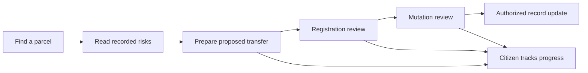
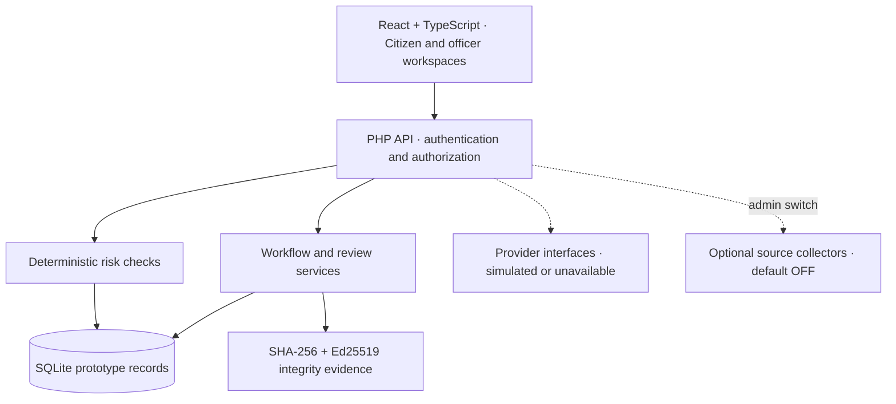

<div align="center">

# 🛡️ BhumiShield · ভূমি সুরক্ষা

### জমি কেনার আগে বুঝুন ঝুঁকি। হস্তান্তরের প্রতিটি ধাপ রাখুন অনুসরণযোগ্য।

**Explainable fraud checks across land registration and mutation**

[](#-competition-focus)
[](#-scope--honest-limitations)
[](#-the-user-journey)
[](#-government-source-collection-control)

[**Open frontend ↗**](https://bhumishield-web.onrender.com) · [**Backend ↗**](https://bhumishield-api.onrender.com) · [**Run locally**](#-run-locally) · [**Documentation**](#-documentation)

*An independent student prototype for LandTech Innovation Hackathon 2026. It is not a government portal, an official title certificate, or a substitute for an authorized land-office decision.*

</div>

---

## 🎯 Competition focus

| | |
|---|---|
| **Track** | Digital Land Records, Verification & Digitization |
| **Primary technical focus** | **P3 — Catch Fraud & Double-Selling** |
| **Core question** | Can we explain transaction risks before a proposed sale, and keep registration and mutation records connected? |
| **Primary users** | Citizens and buyers, sub-registry staff, AC Land staff |
| **Supporting users** | Bank officers, survey/review staff, lawyers, administrators and auditors |
| **Submission stage** | Working prototype; validation and security hardening continue |

The concept note should name **one** problem. Deed integrity (P2), registration–mutation tracking (P4) and the citizen checker (P5) support the P3 story. The team must confirm that this focus matches its registered selection.

### The problem

A buyer may see a deed without understanding whether the recorded seller has enough remaining share, a prior sale is awaiting mutation, or the parcel has a recorded lien or dispute. Meanwhile, registration and mutation history can be difficult to follow across separate workflows.

**BhumiShield brings those checks into one explainable prototype:** a citizen starts with a parcel, sees recorded risks and next steps, and follows an application through the responsible roles. Officers see review queues and traceable decisions instead of treating a document upload as proof of ownership.

> **Illustrative scenario — synthetic data only:** A recorded owner proposes a second sale while a prior sale remains pending. The checker identifies the recorded conflict and explains why an officer must review it. A green result means no configured risk was found in the available prototype records; it does not guarantee legally clear title.

## 🔗 Hosted prototype

| Component | Link | Purpose |
|---|---|---|
| Frontend | [bhumishield-web.onrender.com](https://bhumishield-web.onrender.com) | Citizen and role workspaces |
| Backend | [bhumishield-api.onrender.com](https://bhumishield-api.onrender.com) | Application API |
| Health endpoint | [API health](https://bhumishield-api.onrender.com/api/v1/health) | Basic service/database readiness response |

These deployment addresses were supplied by the team. Their inclusion is not a claim that this repository revision has been deployed, every endpoint is available, or all workflows have passed remote testing. Browser access to the API root is not itself an end-user interface.

## ✨ What the prototype brings together

| Capability | What users can do | Boundary |
|---|---|---|
| **Check before you buy** | Review explainable findings from ownership/share, pending-sale, lien, dispute and record-history checks | Results depend on recorded data; no legal title guarantee |
| **Document integrity** | Verify application records using SHA-256 hashes, Ed25519 signatures and QR verification | Detects certain changes relative to recorded proofs; does not prove original input was true |
| **Connected transfer workflow** | Follow registration and mutation tasks, reviews and application status | Sensitive transitions require further regression hardening |
| **Citizen property vault** | View linked documents, application context and sale-lock controls | Prototype records and permissions; no direct government-record lookup |
| **Office workspaces** | Work through role-specific queues, review stages and administrative controls | National office isolation and every role/action combination are not certified |
| **Parcel workspace** | Explore the map, draw proposed parcels, submit/review designs and propose owner allocation | OSM/reference points are not authoritative cadastral boundaries or legal subdivision approval |
| **Bank and review modules** | Demonstrate recorded lien/NOC and supporting review workflows | No operational bank, court or government integration is claimed |
| **Service guidance** | Link service context, offices and reviewed guidance to a citizen's need | Guidance is informational; public-source collection is off by default |

### A look inside

| Citizen workspace | Parcel design workspace |
|---|---|
|  |  |

*Screenshots document earlier local prototype states; they do not certify the current hosted build or government approval.*

## 🧭 The user journey



The diagram describes the intended workflow. Party consent, office scope, verified payment state and authorized final approval must be enforced at the relevant transitions; the diagram is not evidence that every transition is defect-free.

| User | Main responsibility | Starting point |
|---|---|---|
| Citizen / buyer | Check a parcel, review own records, prepare and track applications | `/bn/home`, `/bn/check` |
| Sub-registrar | Review the proposed deed and registration-stage requirements | `/bn/registrar` |
| AC Land | Review mutation and the configured final ownership-approval step | `/bn/acland` |
| Bank officer | Review recorded collateral, liens and NOC workflows | `/bn/bank` |
| Survey / record staff | Prepare field and parcel evidence within assigned scope | Assigned workspace; `/bn/map` |
| Lawyer / court user | Handle authorized case-related records and review context | `/bn/lawyer_case` |
| Super Admin | Manage users, offices, configuration, source controls and oversight | `/bn/admin` |
| Auditor / reviewer | Inspect evidence and decisions within assigned permissions | Assigned role workspace |

Platform administration must remain separate from a party's consent and legally authorized land decisions. A prototype role name does not confer real governmental authority.

## 🏗️ Architecture



| Layer | Current implementation |
|---|---|
| Frontend | React 19.3.1, TypeScript, Vite 6.4.4, Tailwind CSS 4.3.3 |
| Maps / icons | Leaflet 1.9.4, OpenStreetMap basemap, Lucide React |
| API | PHP with custom routing, services and PDO; Composer autoloading |
| Local database | SQLite; PostgreSQL support exists in code but requires separate integration/load verification |
| Integrity | SHA-256, PHP libsodium / Ed25519 |
| Optional collection | Python standard-library collectors plus a PHP worker, controlled by a shared default-off setting |
| Fonts | Manrope, Hind Siliguri and Noto Sans Bengali |

The runtime uses custom API routing; it is not a standard Laravel application deployment despite Laravel-related metadata in `backend/composer.json`. MySQL support is not claimed. A hash-linked log is not a consensus blockchain, and privileged database/key access remains part of the threat model.

## 🚀 Run locally

### Requirements

- PHP 8.2+ with PDO, `pdo_sqlite`, sodium, JSON and mbstring. PostgreSQL requires `pdo_pgsql`.
- Composer for regenerating the project's autoloader.
- Node.js 20.x and npm for the tested frontend workflow.
- Python 3 only for offline collector tests or future permitted collection; it is not required to use the citizen interface.

### 1. Prepare an isolated local demo database

From a fresh working copy, open a terminal in the repository root:

```sh
cd backend
composer dump-autoload --no-scripts
cp -n .env.example .env
```

In `backend/.env`, set:

```dotenv
APP_ENV=local
APP_DEBUG=true
APP_URL=http://127.0.0.1:8008
DB_CONNECTION=sqlite
DB_DATABASE=database/hackathon-demo.sqlite
ENABLE_SIMULATED_PROVIDERS=true
PUBLIC_VERIFY_BASE_URL=http://localhost:5175
CORS_ALLOWED_ORIGINS=http://localhost:5175,http://127.0.0.1:5175
```

Use unique local-only values for application/JWT signing secrets; example-file values are demo defaults. Keep `.env` private. Simulated providers are for synthetic local demonstrations, never evidence of successful identity checks or payment settlement.

```sh
php artisan migrate --seed
php artisan serve --port=8008
```

This creates/additively prepares the selected local database and seeds demo fixtures. **Use a separate, disposable database. Do not point this setup at an existing service database.** No `migrate:fresh` or destructive reset is needed for this guide.

The source control tables initialize with collection **OFF** when the module is first opened or the worker checks policy. No government-page collection is required for setup.

### 2. Start the frontend

In a second terminal, from the repository root:

```sh
cd frontend
npm ci
```

Create `frontend/.env.local`:

```dotenv
VITE_API_URL=http://127.0.0.1:8008/api/v1
```

```sh
npm run dev
```

Open [localhost:5175](http://localhost:5175). For a hosted frontend, `VITE_API_URL` must point to the intended backend **at build time**; changing the local file does not update an already deployed bundle.

### 3. Use synthetic demo accounts

Only a deliberately seeded local demo database is expected to contain these accounts:

| Role | Username |
|---|---|
| Citizen / seller | `citizen` |
| Citizen / buyer | `rabeya` |
| Sub-registrar | `registrar` |
| AC Land | `acland` |
| Bank officer | `bank` |
| Super Admin | `admin` |

Local fixture password: **`demo123`**. This is not a promise that hosted accounts exist or accept that password. Do not seed public service accounts or deploy shared demo passwords into a real service environment.

## ⏸️ Government-source collection control

**Default: OFF.** The collection code is retained for future use; it is not required for the competition demonstration.

**Super Admin → Integrations → Official sources & information updates → Master collection control**

1. The panel shows whether collection is active or off.
2. An active administrator supplies a reason to change the setting.
3. Manual **Check now**, the scheduled PHP worker, and the service/map Python collection entry points consult the shared application setting before new requests.
4. Changing the global setting does not override a source's individual disabled status. Turning it on does not install or start a scheduler.
5. Actor, reason and time are retained in the control history. Conflicting updates require reloading the latest setting.

Off means **no new collection starts through these paths**. Existing observations, publications and history are retained; an already running request may finish. The worker and API must use the same database for the same policy to apply. Direct Python tools require access to the PHP policy runtime; if the policy cannot be verified, collection is refused. Set `SOURCE_COLLECTION_PHP` to the PHP executable when it is not available on the worker’s PATH.

> **Competition disclosure:** LandTech Rule Book v1.2 prohibits scraping or bulk downloading government websites. Earlier development did collect limited public government-page content; this occurred before the supplied rulebook was checked. The known chat-started worker was stopped, and this revision adds a default-off master control. This does not undo prior collection or establish eligibility. The team must disclose the earlier activity to organizers and obtain their assessment. Keep collection off for judging; any future activation must follow applicable permissions and conditions. No history should be deleted or falsified to conceal prior activity.

## 🧪 Verification

```sh
# Frontend checks
cd frontend
npm run typecheck
npm run build
```

From `backend`, use a **disposable test database**:

```sh
APP_ENV=testing BHUMISHIELD_TEST_DB=/tmp/bhumishield-review.sqlite php artisan test
```

Specialized scripts are separate from the standard runner. For a newly created disposable database, seed synthetic fixtures first, then run the focused collection checks:

```sh
APP_ENV=testing BHUMISHIELD_TEST_DB=/tmp/bhumishield-source-review.sqlite php artisan migrate --seed
APP_ENV=testing BHUMISHIELD_TEST_DB=/tmp/bhumishield-source-review.sqlite php tests/Feature/SourceCollectionControlTest.php
APP_ENV=testing BHUMISHIELD_TEST_DB=/tmp/bhumishield-source-review.sqlite php tests/Feature/SourceIntelligenceTest.php
```

From the repository root, offline parser/security-boundary tests use mocks, not government-page downloads:

```sh
python3 -m unittest discover -s tools/service_sources -p 'test_*.py'
python3 -m unittest discover -s tools/map_sources -p 'test_*.py'
```

**Current verification (18 October):** the focused collection/source checks pass, but the broader backend run reports **125 passed / 3 failed**, and full frontend checking is blocked by syntax errors in `OfficeLocatorPage.tsx`. The changed source panel passes its focused TypeScript check. See the verification note for exact failures; do not treat this revision as a clean release.

The earlier [software-quality audit](docs/SOFTWARE_QUALITY_AUDIT_2026-10-18.md) recorded 128 standard-runner checks and 280 checks across separately invoked suites. Those are dated historical results; later source changes mean they are not a fresh certificate for the current revision. Green tests do not establish complete security or legal correctness. See the [collection-control verification note](docs/COLLECTION_CONTROL_VERIFICATION_2026-10-18.md) for this change's focused results.

## 📋 Data, AI and open-source disclosure

### Data used

- The business-data seeder generates **made-up people, identifiers and land-transaction records** for local demonstrations.
- Later accounts, uploads, screenshots and fixtures must be reviewed separately; a synthetic seeder does not certify every file or database row as synthetic.
- Earlier public government-page observations are a separate data category and are disclosed above. Collection-off does not automatically remove or anonymize them.
- Do not submit real citizens' names, NIDs, phone numbers or real land records. Fully anonymized real documents require organizer approval under the rulebook.
- Required team and mentor identity details belong in the competition submission, not in fabricated business examples.
- Map basemap: **© [OpenStreetMap contributors](https://www.openstreetmap.org/copyright)**. Display attribution is retained. Basemap geography is not an official parcel survey or authoritative land-ownership record.

### AI assistance

| Tool | Use in the project |
|---|---|
| Antigravity | Assisted development, workflow implementation, refactoring and tests |
| OpenAI ChatGPT / Codex | Assisted implementation, local audits, tests, research synthesis and documentation |
| Anthropic Claude | Team-reported assistance with research/writing; a separate concept-note prompt is provided |

AI suggestions are not authoritative legal verification. The two student members remain responsible for original work, design decisions, validating output and explaining the submitted code. The team should reconcile this disclosure with the tools it actually used before submission.

### Credits

React, TypeScript, Vite, Tailwind CSS, Axios, Leaflet, Lucide React, PHP, PDO, libsodium, SQLite, Python and Composer underpin the prototype; dependencies retain their respective licenses. Google Fonts supplies Manrope, Hind Siliguri and Noto Sans Bengali. PostgreSQL is an optional database target requiring verification. Credit public references without implying government endorsement or reuse rights over official records.

## 🔎 Scope & honest limitations

- This is a **working prototype**, not an operational national government platform.
- Real EC/NID verification, face liveness, fingerprint hardware, bank settlement and government gateway agreements have not been demonstrated. Simulated results must be identified as such.
- Critical transfer correctness, consent, document/payment-state, privacy and office-scope findings require remediation and regression testing. See the audit for the exact evidence; some subsequent patches have not been independently reverified.
- Application-generated signatures/receipts do not establish government issuance, payment or legal ownership. Unverified examples must be visibly treated as samples.
- Nationwide office/parcel coverage, production recovery, accessibility conformance and national-scale load capacity are not certified.
- Rule-based risk reports support review; they do not decide disputes or replace due diligence by a competent authority.

### A realistic path to wider use

**Synthetic single-office demonstration → authorized usability/security evaluation → controlled multi-office pilot → staged expansion.**

Before a pilot: resolve competition data compliance; prove actor/office isolation and correct party consent; validate payment/order states; test backup recovery; review accessibility; and obtain separate agreements for any government/provider integration. Measure seeded-scenario detection, false alerts, correct buyer/share persistence and unassisted task completion rather than inventing national impact figures.

## 🎬 Round 1: three-minute demonstration

| Time | Demonstration |
|---|---|
| 0:00–0:30 | Show one citizen problem and the selected P3 focus |
| 0:30–1:15 | Compare a clean synthetic case with a seeded pending-sale/lien conflict; explain the finding |
| 1:15–2:00 | Show linked registration/mutation tasks and citizen tracking; identify simulated or incomplete steps |
| 2:00–2:35 | Demonstrate application-record integrity and supporting parcel/office context |
| 2:35–3:00 | Show collection OFF, name key limitations and close with the next validation milestone |

Use pre-arranged synthetic records. Do not perform live scraping, real identity checks, actual payments or government submissions. **Round 1 video: at most three minutes.** The final round's five-minute pitch/live demo and three-minute Q&A are separate.

## 📚 Documentation

| Document | What it covers |
|---|---|
| [Architecture](docs/ARCHITECTURE.md) | System design and workflow background |
| [Rule engine](docs/RULES.md) | Risk checks and configured ownership guard |
| [Integration boundaries](docs/INTEGRATION.md) | Proposed provider contracts and external dependencies |
| [Map workspace](docs/MAP_WORKSPACE_IMPLEMENTATION_2026-10-18.md) | Map layers, sources and workspace boundaries |
| [Parcel design & allocation](docs/PARCEL_DESIGN_AND_OWNER_ALLOCATION_2026-10-18.md) | Proposed parcels, review and owner-allocation workflow |
| [Software-quality audit](docs/SOFTWARE_QUALITY_AUDIT_2026-10-18.md) | Dated findings, test evidence and remaining risks |
| [Rulebook / README review](docs/RULEBOOK_COMPLIANCE_REVIEW_2026-10-18.md) | Review of the previous README against the supplied v1.2 rulebook |
| [Collection-control verification](docs/COLLECTION_CONTROL_VERIFICATION_2026-10-18.md) | Default-off control and focused checks |
| [Claude concept-note prompt](docs/CLAUDE_CONCEPT_NOTE_PROMPT_2026-10-18.md) | Four-page concept-note writing brief |

Older technical documents may describe intended behavior or earlier implementations. Where claims conflict, verify against the current source and dated audit; do not treat historical prose as evidence of production readiness.

### Submission checklist

- [ ] Confirm the registered primary problem and two eligible students + faculty/industry mentor roster.
- [ ] Resolve earlier collection activity with the organizers; keep collection off and review all submitted data/assets.
- [ ] Share the GitHub/GitLab repository with organizers and preserve genuine commit history.
- [ ] Include a PDF concept note of **up to four pages**, with team/mentors and all required subject areas.
- [ ] Supply the actual **up-to-three-minute** demo video; live link is optional.
- [ ] Check the platform's exact submission cutoff and any rule updates. The supplied rulebook lists **18 October 2026** for Round 1.

### Change record · 18 October 2026

Added the shared default-off collection control, Super Admin activation/deactivation with reasons and history, backend/worker/Python enforcement and focused regression checks. Reworked this README around one primary technical focus, actual stack, hosted links, reproducible local instructions, disclosures and explicit prototype limits. This is a development change record, not a claim of post-Round-1 submission or deployment.

---

<div align="center">

**ভূমি সুরক্ষা — স্পষ্ট তথ্য, অনুসরণযোগ্য সিদ্ধান্ত, সচেতন নাগরিক।**

*Built for a practical LandTech prototype; evaluated honestly, improved incrementally.*

</div>
