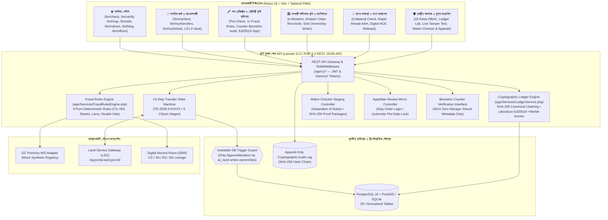

# আর্কিটেকচার ও কনসেপ্ট নোট — ভূমি সুরক্ষা (BhumiShield v2)

> **পিচ লাইন (Pitch Line):**  
> *"Registration and mutation don't talk to each other. We built the layer that checks every deed before it is registered, and proves afterwards that it was never tampered with."*  
> *(সাব-রেজিস্ট্রি ও ই-নামজারি সিস্টেম একে অপরের সাথে কথা বলে না। আমরা এমন একটি স্বাধীন বিশ্বাস স্তর তৈরি করেছি যা নিবন্ধনের আগেই প্রতিটি দলিল যাচাই করে এবং নিবন্ধনের পরে প্রমাণ করে যে দলিলের কোনো তথ্য পরিবর্তন করা হয়নি।)*

---

## ১. এক পাতার কনসেপ্ট নোট সারাংশ (One-Page Concept Note)

### সমস্যা (The Problem)
বাংলাদেশে ই-নামজারি (e-Mutation), ডিজিটাল রেকর্ড রুম (DRR) এবং অনলাইন বালাম ডিজিটাইজেশন চালু হলেও ভূমির মালিকানা হস্তান্তর প্রক্রিয়ায় কয়েকটি সংকট বিদ্যমান:
1. **বিচ্ছিন্ন সিস্টেম:** দলিল নিবন্ধন (সাব-রেজিস্ট্রি অফিস, আইন মন্ত্রণালয়) এবং নামজারি/খতিয়ান হালনাগাদ (এসি ল্যান্ড অফিস, ভূমি মন্ত্রণালয়) দুটি সম্পূর্ণ ভিন্ন মন্ত্রণালয়ের সিস্টেমে পরিচালিত হয়।
2. **নিবন্ধন-পূর্ব যাচাইয়ের অভাব:** দলিল রেজিস্ট্রির মুহূর্তে সাব-রেজিস্ট্রারের কাছে স্বয়ংক্রিয়ভাবে সর্বশেষ বিএস খতিয়ানের মালিকানা অংশ, পূর্ববর্তী অনিষ্পন্ন বিক্রয় দলিল বা ব্যাংকের সক্রিয় বন্ধক (Lien) যাচাইয়ের কোনো তাৎক্ষণিক গেটকিপার টুল নেই।
3. **নিবন্ধন-পরবর্তী টেম্পারিং ও ডাটা পরিবর্তন:** জাল দলিল তৈরি, একই জমি একাধিক ক্রেতার কাছে বিক্রি (Double Sale), নিজের অংশের চেয়ে বেশি জমি বিক্রি, এবং বালাম/ডাটাবেজে জমির পরিমাণ গোপনে পরিবর্তন করার ঝুঁকি থেকে যায়।
4. **অনৈতিক মালিকানা পরিবর্তন:** স্থানীয় ভূমি সহকারী কর্মকর্তা বা সাব-রেজিস্ট্রি থেকে যেকোনো রিকোয়েস্টে সরাসরি ডাটাবেজে মালিকের নাম বদলে দেওয়ার ঝুঁকি।

### সমাধান: ভূমি সুরক্ষা (BhumiShield v2)
**ভূমি সুরক্ষা (BhumiShield)** কোনো বিদ্যমান সরকারি সিস্টেমকে প্রতিস্থাপন করে না; বরং একটি **স্বাধীন ক্রিপ্টোগ্রাফিক ট্রাস্ট ও ভেরিফিকেশন লেয়ার (Independent Trust Layer)** হিসেবে কাজ করে:
1. **১৩-ধাপের হস্তান্তর স্টেট মেশিন (13-Step Transfer State Machine):** শুরু থেকে শেষ পর্যন্ত (DRAFT → VERIFY → REGISTER → MUTATION → DONE) প্রতিটি পর্যায় কঠোর স্টেট ট্রানজিশনে নিয়ন্ত্রিত।
2. **অপরিবর্তনীয় মালিকানা নীতি (Inviolable Ownership Guard):** শুধুমাত্র **এসি ল্যান্ড (`ac_land`) কর্তৃক নামজারি অনুমোদন (`ApproveMutation`)** ব্যতীত ডাটাবেজে কোনো ইউজার, অ্যাডমিন বা সিস্টেম রোল `ownerships` টেবিলে পরিবর্তন করতে পারে না (ডাটাবেজ ট্রিগার দ্বারা সুরক্ষিত)।
3. **নিবন্ধন-পূর্ব ৯টি জালিয়াতি রুলস ইঞ্জিন:** দলিল স্বাক্ষরের আগেই সিএস→এসএ→আরএস→বিএস খতিয়ান চেইন, মালিকানা ভগ্নাংশ (`১/২`, `১/১`), ডাবল সেল, ব্যাংক মর্টগেজ, উত্তরাধিকার ফারায়েজ এবং মক এনআইডি যাচাই করে।
4. **টেম্পার-এভিডেন্ট হ্যাশ-চেইন ও Ed25519 ডিজিটাল স্বাক্ষর:** প্রতিটি নিবন্ধিত দলিল ক্যানোনিকাল JSON আকারে `SHA-256` হ্যাশ করে পূর্ববর্তী দলিলের হ্যাশের (`prev_hash`) সাথে যুক্ত করা হয় এবং সাব-রেজিস্ট্রারের `Ed25519` প্রাইভেট কি দিয়ে ডিজিটাল স্বাক্ষর করা হয়। সাথে থাকে ডেইলি মার্কেল রুট এবং পাবলিক কিউআর কোড।
5. **মেকার-চেকার স্ট্যাজিং ও আপিল ট্রাইব্যুনাল:** ডিজিটালাইজেশন রেকর্ড যাচাইয়ে চার-চোখের নীতি (Four-Eyes Principle) এবং আপিল আদালতে স্থগিতাদেশ জারির সাথে সাথে প্লট স্বয়ংক্রিয় লক।

---

## ২. সিস্টেম আর্কিটেকচার ডায়াগ্রাম (Mermaid System Architecture)



---

## ৩. ১৩-ধাপের ভূমি হস্তান্তর ও মালিকানা সুরক্ষা সিকোয়েন্স ডায়াগ্রাম

```mermaid
sequenceDiagram
    autonumber
    actor Citizen as নাগরিক (Citizen)
    actor SubReg as সাব-রেজিস্ট্রার (Sub-Registrar)
    participant API as BhumiShield API (Laravel 11)
    participant Engine as Fraud Rules Engine
    participant Ledger as Ed25519 Hash Chain
    actor ACLand as সহকারী কমিশনার (ভূমি) (AC Land)
    participant DB as Protected Database (DB Triggers)

    Note over Citizen,DB: ১. খসড়া ও পূর্ব-যাচাই (Draft & Pre-Registration Verification)
    Citizen->>API: POST /api/v1/transfers (দলিল খসড়া ও দাগ নির্বাচন)
    API->>Engine: ৯টি স্বয়ংক্রিয় নিয়ম মূল্যায়ন (খতিয়ান চেইন, অংশ, বন্ধক, ডাবল সেল)
    Engine-->>API: রায় (SAFE / REVIEW / HIGH_RISK) + বাংলায় কারণ
    API-->>Citizen: খসড়া সংরক্ষিত (TR-2026-XXXXXX, স্ট্যাটাস: DRAFT)

    Note over Citizen,SubReg: ২. সহ-মালিক সম্মতি ও বায়োমেট্রিক কাউন্টার যাচাই
    Citizen->>API: সহ-মালিক ও ওয়ারিশদের ডিজিটাল সম্মতি (COOWNER_CONSENTED)
    Citizen->>SubReg: সাব-রেজিস্ট্রি অফিসে কাউন্টারে সশরীরে উপস্থিতি
    SubReg->>API: বায়োমেট্রিক ফলাফল অডিট রেকর্ড দাখিল (BIOMETRICS_VERIFIED)
    Note right of SubReg: কোনো ফেস বা ফিঙ্গারপ্রিন্ট টেমপ্লেট সেভ হয় না; শুধু ট্রানজ্যাকশন আইডি ও স্কোর রেকর্ড হয়

    Note over SubReg,Ledger: ৩. সাব-রেজিস্ট্রার স্বাক্ষর ও ডিজিটাল সিল (Deed Registration)
    SubReg->>API: POST /api/v1/registrar/register-deed
    API->>Ledger: Canonical JSON + SHA-256 + prev_hash চেইনিং
    Ledger->>Ledger: সাব-রেজিস্ট্রারের Ed25519 প্রাইভেট কি দিয়ে ডিজিটাল স্বাক্ষর
    Ledger-->>API: হ্যাশ-চেইনে নিবন্ধিত দলিল (DEED_REGISTERED)
    API->>API: ই-নামজারি কিউতে স্বয়ংক্রিয় স্থানান্তর (MUTATION_PENDING)

    Note over ACLand,DB: ৪. অপরিবর্তনীয় মালিকানা নামজারি (Inviolable Ownership Mutation)
    ACLand->>API: POST /api/v1/mutations/{id}/decide (অনুমোদন)
    API->>DB: DB Trigger verifies role = 'ac_land' & action = 'ApproveMutation'
    DB->>DB: বিক্রেতার অংশ কর্তন এবং ক্রেতার নতুন বিএস মালিকানা রেকর্ড (OWNERSHIP_MUTATED)
    Note over DB: অন্য কোনো রোল বা এন্ডপয়েন্ট মালিকানা পরিবর্তন করতে পারে না (Trigger blocked)

    Note over Citizen,DB: ৫. নাগরিক ও পাবলিক কিউআর যাচাই (Public Verification)
    Citizen->>API: GET /api/v1/verify/deed/{code} (QR স্ক্যান)
    API->>Ledger: রি-কম্পিউট SHA-256 ও Ed25519 স্বাক্ষর সত্যতা যাচাই
    Ledger-->>Citizen: ✔ নিরাপদ ও অপরিবর্তিত সনদ (COMPLETED)
```

---

## ৪. ১৮টি RBAC রোলের ডিরেক্টরি ও নিয়ন্ত্রিত দায়িত্ব (Role Directory)

| রোল ক্যাটাগরি | কোড | নাম (বাংলা) | মূল দায়িত্ব ও পরিধি |
| :--- | :--- | :--- | :--- |
| **১. নাগরিক (T1)** | `citizen` | সাধারণ নাগরিক | জমি যাচাই, সম্পত্তি ভল্ট (L0-L3), বিক্রয় লক, আপত্তি দাখিল, টিকেট ও ট্র্যাকিং |
| | `service_point_operator` | সার্ভিস পয়েন্ট অপারেটর (ইউডিসি) | নাগরিকের পক্ষে ৭ দিনের ডেলিগেটেড অ্যাক্সেসে আবেদন ও রেকর্ড উত্তোলন সহায়তা |
| **২. নিবন্ধন অধিদপ্তর (T2)** | `sub_registrar` | সাব-রেজিস্ট্রার | দলিল প্রাক-যাচাই, ১১টি জালিয়াতি রুল গেটকিপার, বায়োমেট্রিক অডিট, Ed25519 সিল |
| | `registry_data_officer` | রেজিস্ট্রি ডাটা অফিসার (মেকার) | পুরোনো বালাম ও ড্রাফট দলিলের ডাটা এন্ট্রি ও মেকার ব্যাচ প্রস্তুতকরণ |
| | `registry_auditor` | রেজিস্ট্রি ইন্সপেক্টর / অডিটর | সাব-রেজিস্ট্রি দলিলের ফিজিক্যাল বালামের সাথে ডিজিটাল হ্যাশের ক্রস-অডিট |
| **৩. ভূমি রাজস্ব প্রশাসন (T2)** | `ac_land` | সহকারী কমিশনার (ভূমি) | **একমাত্র অনুমোদিত মালিকানা পরিবর্তনকারী (`ApproveMutation`)**, বিরোধ নিষ্পত্তি |
| | `land_office_assistant` | সহকারী কর্মকর্তা / তহশিলদার | ইউনিয়ন ভূমি রিপোর্ট, সরজমিন দাগ যাচাই ও মেকার ব্যাচ এন্ট্রি |
| | `field_verification_officer`| সার্ভেয়ার / কানুনগো | সীমানা বিরোধ, সরেজমিন পরিদর্শন ও জিও-পলিগন যাচাই |
| | `kanungo` | প্রধান কানুনগো | খতিয়ানের হিস্যা ও নকশা মিল যাচাই |
| **৪. সেটেলমেন্ট প্রশাসন (T2)** | `settlement_records_officer`| সেটেলমেন্ট অফিসার (মেকার) | সিএস/এসএ/আরএস/বিএস ডিজিটাল রেকর্ড প্রস্তুত ও চার-চোখের ব্যাচ সাবমিট |
| | `settlement_checker` | সেটেলমেন্ট সুপারভাইজার (চেকার) | ড্রাফট খতিয়ানের ভুল সংশোধন ও অনুমোদনের সুপারিশ |
| **৫. আপিল ও বিচার বিভাগীয় (T2)** | `appellate_reviewer` | অতিরিক্ত জেলা প্রশাসক (রাজস্ব) | নামজারি আপিল ট্রাইব্যুনাল শুনানি ও রায় প্রদান |
| | `uno_supervisor` | উপজেলা নির্বাহী কর্মকর্তা | উপজেলা স্তরের রিভিউ ট্রাইব্যুনাল ও **স্থগিতাদেশে প্লট লক কার্যকর** |
| **৬. আর্থিক প্রতিষ্ঠান (T2)**| `bank_officer` | ব্যাংক ঋণ কর্মকর্তা | মর্টগেজ জামানত যাচাই, দ্বৈত বন্ধক প্রতিরোধে প্লট লক, ডিজিটাল NOC আবেদন |
| | `bank_manager` | ব্যাংক শাখা ব্যবস্থাপক | চূড়ান্ত ঋণ অবমুক্তি অনুমোদন ও অপরিবর্তনীয় ডিজিটাল NOC সনদ ইস্যু |
| **৭. প্রশাসন ও কারিগরি (T2)** | `admin` | সিস্টেম অ্যাডমিনিস্ট্রেটর | ইউজার ডিরেক্টরি, সাইট সেটিংস পলিসি, সার্ভিস ফি রেজিস্ট্রি, অডিট ট্রেইল |
| | `system_admin` | আইটি ইনফ্রাস্ট্রাকচার অ্যাডমিন | ব্যাকআপ, ক্রিপ্টোগ্রাফিক কি রোটেশন ও হোস্ট সিকিউরিটি |
| | `support_agent` | হেল্পডেস্ক সাপোর্ট এজেন্ট | নাগরিক টিকেট পর্যালোচনা, এসএমএস নোটিফিকেশন সমন্বয় ও এসএলএ নিশ্চিতকরণ |
