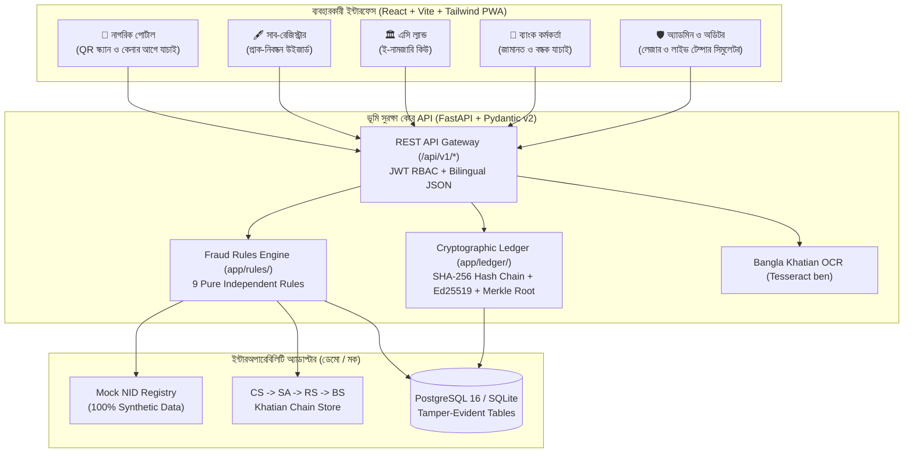
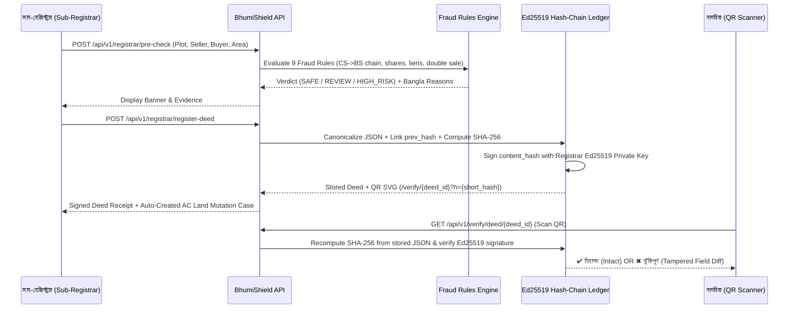

# আর্কিটেকচার ও কনসেপ্ট নোট — ভূমি সুরক্ষা (BhumiShield)

> **পিচ লাইন (Pitch Line):**  
> *"Registration and mutation don't talk to each other. We built the layer that checks every deed before it is registered, and proves afterwards that it was never tampered with."*  
> *(সাব-রেজিস্ট্রি ও ই-নামজারি সিস্টেম একে অপরের সাথে কথা বলে না। আমরা এমন একটি স্বাধীন বিশ্বাস স্তর তৈরি করেছি যা নিবন্ধনের আগেই প্রতিটি দলিল যাচাই করে এবং নিবন্ধনের পরে প্রমাণ করে যে দলিলের কোনো তথ্য পরিবর্তন করা হয়নি।)*

## ১. এক পাতার কনসেপ্ট নোট সারাংশ (One-Page Concept Note Summary)

### সমস্যা (The Problem)
বাংলাদেশে ই-নামজারি (e-Mutation), ডিজিটাল রেকর্ড রুম (DRR) এবং অনলাইন দলিল ডিজিটাইজেশন চালু থাকলেও:
1. **বিচ্ছিন্ন সিস্টেম:** দলিল নিবন্ধন (সাব-রেজিস্ট্রি অফিস, আইন মন্ত্রণালয়) এবং নামজারি/খতিয়ান হালনাগাদ (এসি ল্যান্ড অফিস, ভূমি মন্ত্রণালয়) দুটি ভিন্ন সিস্টেমে পরিচালিত হয়।
2. **নিবন্ধন-পূর্ব যাচাইয়ের অভাব:** দলিল রেজিস্ট্রির মুহূর্তে সাব-রেজিস্ট্রারের কাছে স্বয়ংক্রিয়ভাবে সর্বশেষ বিএস খতিয়ানের মালিকানা অংশ, পূর্ববর্তী অনিষ্পন্ন বিক্রয় দলিল বা ব্যাংকের সক্রিয় বন্ধক (Lien) যাচাইয়ের রিয়েল-টাইম টুল নেই।
3. **নিবন্ধন-পরবর্তী টেম্পারিং ও জালিয়াতি:** জাল দলিল তৈরি, একই জমি একাধিক ক্রেতার কাছে বিক্রি (Double Sale), নিজের অংশের চেয়ে বেশি জমি বিক্রি, এবং বালাম/ডাটাবেজে জমির পরিমাণ গোপনে পরিবর্তন করার ঝুঁকি থেকে যায়।

### সমাধান: ভূমি সুরক্ষা (BhumiShield)
**ভূমি সুরক্ষা (BhumiShield)** কোনো বিদ্যমান সরকারি সিস্টেমকে প্রতিস্থাপন করে না; বরং একটি **স্বাধীন ক্রিপ্টোগ্রাফিক ট্রাস্ট ও ভেরিফিকেশন লেয়ার (Independent Trust Layer)** হিসেবে তাদের মধ্যে সংযোগ স্থাপন করে:
1. **নিবন্ধন-পূর্ব মালিকানা ও জালিয়াতি যাচাই (Pre-Registration Fraud Engine):** দলিল স্বাক্ষরের আগেই ৯টি স্বয়ংক্রিয় নিয়মের মাধ্যমে সিএস→এসএ→আরএস→বিএস খতিয়ান চেইন, মালিকানা ভগ্নাংশ (`১/২`, `১/১`), ডাবল সেল, ব্যাংক মর্টগেজ এবং মক এনআইডি যাচাই করে।
2. **টেম্পার-এভিডেন্ট হ্যাশ-চেইন লেজার ও Ed25519 স্বাক্ষর:** প্রতিটি নিবন্ধিত দলিল ক্যানোনিকাল JSON আকারে `SHA-256` হ্যাশ করে পূর্ববর্তী দলিলের হ্যাশের (`prev_hash`) সাথে যুক্ত করা হয় এবং সাব-রেজিস্ট্রারের `Ed25519` প্রাইভেট কি দিয়ে ডিজিটাল স্বাক্ষর করা হয়। সাথে একটি ডেইলি মার্কেল রুট (Daily Merkle Root Anchor) এবং পাবলিক কিউআর কোড (`QR Code`) তৈরি হয়।
3. **নাগরিকদের জন্য সহজ বাংলায় ‘জমি কেনার আগে যাচাই’ (Check Before You Buy):** যেকোনো সাধারণ নাগরিক লগইন ছাড়াই QR কোড স্ক্যান করে বা মৌজা-দাগ নম্বর দিয়ে এক পাতার সহজ বাংলা রিপোর্ট (ও `🔊 শুনুন` অডিও পাঠ) পেতে পারেন।

> **আইনি নীতি (Legal Advisory Principle):**  
> ভূমি সুরক্ষা শুধুমাত্র সম্ভাব্য ঝুঁকি ও তথ্যের অমিল চিহ্নিত করে মানব কর্মকর্তাকে (সাব-রেজিস্ট্রার / এসি ল্যান্ড) সিদ্ধান্ত নিতে সহায়তা করে; এটি কখনোই চূড়ান্ত আইনি মালিকানা ঘোষণা করে না।

## ২. সিস্টেম আর্কিটেকচার ডায়াগ্রাম (Mermaid Architecture Diagram)

## ৩. ক্রিপ্টোগ্রাফিক হ্যাশ-চেইন ও ভেরিফিকেশন ফ্লো (Sequence Diagram)

