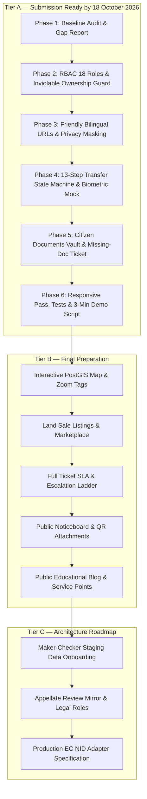

# BhumiShield (ভূমি সুরক্ষা) — Gap Report (v1 → v2 Upgrade)

**Date:** 2026-10-17  
**Context:** LandTech Innovation Hackathon 2026 (Daffodil International University)  
**Track:** Digital Land Records, Verification & Digitization  
**Specification:** UPGRADE PROMPT v2 (Antigravity)

---

## 1. Executive Summary

This report establishes the baseline comparison between the current production-ready BhumiShield codebase and the Hackathon v2 Specification.

- **Backend Status:** Already running on Laravel 11.0 (PHP 8.4) with custom PDO SQLite/PostgreSQL layer, ext-sodium Ed25519 signatures, SHA-256 hash chaining, and 47 green tests. No language port is needed (M1 is fulfilled).
- **Core Principles Maintained:** All 8 hackathon demo scenarios, 9 fraud detection rules, Bangladesh flag visual branding (`#006A4E`, `#F42A41`, `#C4891A`), and Hind Siliguri Bangla typography will remain intact.
- **Primary Upgrades Required:**
  1. Transition from 5 simple roles to an 18-role RBAC architecture with jurisdiction scoping.
  2. Implement an inviolable DB-level guard ensuring **only `ApproveMutation` (role `ac_land`)** can mutate `ownerships`.
  3. Expand the deed registration and mutation flow into the **13-step transfer state machine** with mock biometric counter verification.
  4. Migrate to friendly bilingual `/bn` and `/en` slug/code-based routing.
  5. Build the Citizen Documents Vault with trust levels (L0–L3) and 2-tap pre-filled ticket submission.
  6. Add new schema tables for offices, appointments, transfers, documents, tickets, listings, notices, and blog.

---

## 2. KEEP (Already Correct — Do Not Rewrite)

The following components are robust, tested, and meet or exceed the v2 specification requirements:

1. **The 8 Seeded Demo Scenarios:**
   - Scenario 1 (`CLEAN_SALE`): Dag 101, Deed DL-2026-1001 → Verdict `SAFE`
   - Scenario 2 (`DOUBLE_SALE`): Dag 102, Deed DL-2026-1002 → Verdict `HIGH_RISK`
   - Scenario 3 (`AREA_EXCEEDS_OWNED`): Dag 103, 18 dec vs 12 dec → Verdict `HIGH_RISK`
   - Scenario 4 (`SELLER_NOT_OWNER`): Dag 104, non-owner seller → Verdict `HIGH_RISK`
   - Scenario 5 (`DEED_TAMPERED`): Dag 105, Deed DL-2026-1005 → Verdict `HIGH_RISK`
   - Scenario 6 (`PLOT_MORTGAGED`): Dag 106, active Sonali Bank lien → Verdict `HIGH_RISK`
   - Scenario 7 (`KHATIAN_CHAIN_BREAK`): Dag 107, RS 18 dec to BS 26 dec → Verdict `REVIEW`
   - Scenario 8 (`INHERITANCE_UNRESOLVED`): Dag 108, deceased owner → Verdict `REVIEW`

2. **The 9 Fraud & Discrepancy Detection Rules (`FraudRulesEngine.php`):**
   - Pure, deterministic calculation of `SELLER_NOT_OWNER`, `AREA_EXCEEDS_OWNED`, `DOUBLE_SALE`, `KHATIAN_CHAIN_BREAK`, `DEED_TAMPERED`, `PLOT_MORTGAGED`, `RAPID_RESALE`, `INHERITANCE_UNRESOLVED`, and `NID_MISMATCH`.
   - Produces structured bilingual findings with severity, score deltas, and actionable guidance.

3. **Cryptographic Deed Ledger & Audit Log (`LedgerService.php`):**
   - Canonical JSON serialization with recursive key sorting.
   - SHA-256 hash chaining of deed envelopes and audit entries.
   - Ed25519 digital signatures using native PHP `libsodium` (`sodium_crypto_sign_detached`).
   - Tamper simulation and automatic tamper detection.

4. **Existing 47 Automated Tests:**
   - 18 tests in `RulesAndLedgerTest` (rules, scenarios, ledger tampering, role workflows).
   - 29 regression tests in `RoleAuditRegressionTest` (findings F01–F22, I01–I08).

5. **In-Panel Officer Utilities:**
   - `OfficerKhatianExplorer.tsx`: Historical CS → SA → RS → BS lineage explorer with joint holding breakdown and dispute/lock indicators.
   - `OfficerDeedVerifier.tsx`: Digital signature and block hash validator with interactive tamper testing.

6. **Branding, Theme, and Accessibility Tokens:**
   - Bangladesh flag colors: Bottle Green (`#006A4E`), National Red (`#F42A41`), Amber (`#C4891A`).
   - `Hind Siliguri` primary Bengali typography with 18px base text size and 48px touch targets.
   - High-contrast toggle, text size zoom, and WCAG AA compliance.

7. **Service Catalogue & Statutory Fee Registry (`ServiceCatalogueController.php`):**
   - 6 official Bangladesh land services linked to `mutation.land.gov.bd`, `lsg-portal.land.gov.bd`, `ldtax.gov.bd`, and `settlement.gov.bd`.
   - Statutory fee schedules reflecting Ministry Circular dated 17 February 2026.

---

## 3. MODIFY (Must Change — Explicit Modifications M1–M12)

| # | Item | Current Implementation | Target Specification (v2) | Rationale |
|---|---|---|---|---|
| **M1** | Backend Framework | Laravel 11.0 on PHP 8.4 is already in place. | Preserve Laravel JSON API, Eloquent models, and artisan commands. | Team requirement already met; no port needed. |
| **M2** | Role Storage & RBAC | Single string column `role` in `users` with 5 roles (`citizen`, `sub_registrar`, `ac_land`, `bank_officer`, `admin`). | Granular RBAC supporting all 18 roles specified in Section 4.2 with permission matrices (Section 4.4) and jurisdiction scoping (`office_id`, division, district, upazila, mouza set). Seed 1 demo user per role. | Multi-tier administrative governance and least privilege. |
| **M3** | Ownership Guard | Ownership updates happen in `WorkflowController::decideMutationCase` AND `RoleControlController::reconcileKhatianPlot`. | **Remove every code path that writes to `ownerships` except `ApproveMutation` (role `ac_land`).** Implement an inviolable DB-level guard (trigger or strict application writer check) and add automated tests proving all other roles/methods fail closed. | Constitutional authority rule: only AC Land can change ownership. |
| **M4** | Transfer State Machine | Ad-hoc register deed endpoint → pending mutation queue. | **13-step transfer state machine** (`transfer_requests`, `transfer_events`, `transfer_parties`, `transfer_consents`). 5 friendly citizen stages (Start, Verify, Register, Review, Done). Link existing deeds/mutations to initial transfer requests. | Complete end-to-end land transaction lifecycle. |
| **M5** | Privacy Masking | Partial masking on persons list and public deed verifier. | Rigorous enforcement across all endpoints: NID last 4 only to the owner; phone numbers never exposed to third parties; non-party names masked (First name + `***`); prices visible only to transaction parties, Sub-Registrar, and AC Land; banks see collateral value only. | Data privacy and citizen security. |
| **M6** | Friendly URLs & Slugs | Tab/query parameter navigation (`/?tab=check&plot_id=101`). | **Prefix all routes with `/bn` or `/en`** with public alphanumeric codes and slugs (e.g. `/bn/check/...`, `/bn/verify/D-8F3K2Q`, `/bn/plots/PLT-DHK-ASH-101`, `/bn/my/land/...`). Add 301 redirects for backwards compatibility. Never expose raw integer IDs. | User experience and speakable reference codes. |
| **M7** | Navigation Structure | Top navbar with simple tab links. | Public Navigation: Map, Sale, Notices, Blog, Offices, Help. Citizen Navigation: My Land, My Transfers, My Tickets, Alerts. Scoped Officer Navigation per role. | Clean citizen-first and officer-specific workflows. |
| **M8** | Database Schema Extension | 14 core tables. | Add 16+ new tables from Section 7 without dropping existing ones (`offices`, `appointments`, `case_access_grants`, `transfer_requests`, `biometric_verifications`, `plot_documents`, `document_templates`, `tickets`, `sla_policies`, `listings`, `notices`, `blog_posts`, etc.). | Support v2 modular features. |
| **M9** | Full Bilingual Strings | UI is mostly bilingual; some newer backend messages and seed descriptions are single-language. | Complete Bengali and English strings for all new screens and error messages. Zero hardcoded single-language text. | Bangla-first requirement. |
| **M10** | Seed Data Expansion | 7 demo accounts, 60 plots, 80 deeds, 8 scenarios. | Extend seeder with offices, service points, demo users for all 18 roles, document templates with all statuses (L0–L3), sample tickets, listings, notices with attachments, and blog posts. | Comprehensive hackathon demonstration readiness. |
| **M11** | Documentation Update | Docs reflect earlier interim audits. | Update `README.md`, `docs/ARCHITECTURE.md` (Mermaid), `docs/INTEGRATION.md` (EC NID, Land Service Gateway, Biometric Provider), `docs/RULES.md`, and write `docs/DEMO_SCRIPT.md` (v2 3-minute timed script). | Evaluation criteria. |
| **M12** | Automated Test Suite | 47 existing feature/regression tests. | Add tests for: ownership guard enforcement, 13-step state machine transitions, 18-role permission matrix, privacy masking verification, ticket SLA tracking, and biometric result handling. | Safety and reliability. |

---

## 4. ADD (New Capabilities & Modules)

### 4.1 Schema Tables (Section 7)
- `offices`: Registry offices, AC Land offices, Union Land offices, Settlement offices, and Service Points with coordinates and jurisdictions.
- `office_user`: Assignment of officers to offices and jurisdictions.
- `appointments`: Booking slots at registry offices or service points.
- `case_access_grants`: Time-limited (default 7 days) case-scoped access for Service Points.
- `transfer_requests`: The core 13-step transfer state entity (`TR-2026-XXXXXX`).
- `transfer_parties`: Sellers, buyers, and heirs associated with a transfer.
- `transfer_consents`: Co-owner OTP consents with timestamps and status.
- `transfer_events`: Immutable state transition audit trail (who, when, from, to, reason).
- `biometric_verifications`: Counter biometric audit record (transaction ID, party, match yes/no, score, terminal ID, officer ID).
- `plot_documents`: Citizen and official documents per plot with trust levels (`L3` Official, `L2` Verified copy, `L1` Citizen-uploaded, `L0` Missing), file paths, SHA-256 hashes, and verification metadata.
- `document_templates`: Expected documents checklist based on acquisition type (sale, inheritance, gift, original survey).
- `tickets`: Citizen and officer support ticket management (`TKT-2026-XXXXXX`).
- `ticket_messages`: Public replies and internal officer notes.
- `ticket_events`: Ticket assignment, SLA tracking, and status changes.
- `sla_policies`: Service Level Agreement targets (first reply 1–3 days, resolution 2–30 days).
- `listings`: Citizen land sale marketplace listings (only verified owners, unanimous co-owner consent, unencumbered).
- `listing_enquiries`: Secure in-app buyer inquiries (no phone exposure).
- `plot_geometries`: Synthetic PostGIS polygon coordinates for cadastral map representation.
- `notices`: Official public notices with categories and jurisdictions.
- `notice_attachments`: Notice files with SHA-256 hash and QR verification seal.
- `blog_posts` & `blog_categories`: Public land literacy guides and awareness articles.
- `onboarding_batches` & `onboarding_items`: Staging area for maker–checker production data entry.
- `appeals`: Mirror records for appellate reviews and court orders.

### 4.2 Interfaces & Services
- **`BiometricProvider` Interface:**
  - `MockProvider`: Simulates counter biometric terminal with browser camera liveness demonstration and fingerprint sensor button. Storing **only** result records; no biometric templates or face images are ever stored.
  - `EcNidProvider`: Documented architecture stub for production integration with Bangladesh Election Commission NID wing.
- **`TransferStateMachine` Service:**
  - Handles all 13 transitions, enforces pre-requisites (OTP, biometrics, deed registration, AC Land sign-off), and disallows illegal skips.
- **`DocumentVaultService`:**
  - Evaluates expected vs present documents per plot and computes trust levels (`L0` to `L3`).
  - Powers the 2-tap missing-document ticket trigger.
- **`TicketManagementService`:**
  - Auto-routing based on issue category, SLA clock calculation, and 4-tier escalation ladder.

### 4.3 Frontend Pages & Modules
- `/bn/my/land/{plot_code}/documents`: Citizen Documents Vault with trust level badges and pre-filled missing-document ticket trigger.
- `/bn/my/transfers`: Citizen transfer wizard and tracking (5 friendly stages).
- `/bn/my/tickets`: Ticket submission, live tracking, and conversation thread.
- `/bn/sale`: Public land sale browse page with filters, risk verdict chips, and in-app inquiry modal.
- `/bn/notices`: Public noticeboard with downloadable QR-sealed attachments.
- `/bn/blog`: Public educational blog.
- `/bn/map`: Interactive plot and mouza map with zoom-aware sale tags.

---

## 5. Implementation Roadmap (Tiered Strategy)

---

## 6. Definition of Done Checklist for Tier A

- [x] Step 0 complete: `docs/CURRENT_STATE.md` and `docs/GAP_REPORT.md` created.
- [ ] Phase 2 complete: All 18 roles seeded with demo accounts; DB-level guard restricts `ownerships` writes strictly to `ac_land` (`ApproveMutation`); automated test passes.
- [ ] Phase 3 complete: Friendly `/bn` and `/en` routes active with 301 redirects; privacy masking verified on all public and citizen endpoints.
- [ ] Phase 4 complete: Transfer state machine operational with all 13 steps; mock biometric counter check required before deed registration; AC Land acts as sole mutation approver.
- [ ] Phase 5 complete: Plot documents vault displays L0–L3 trust levels; missing document button creates pre-filled ticket in 2 taps.
- [ ] Phase 6 complete: Layout verified at 360px, 768px, and 1280px with AA contrast; all 8 original demo scenarios pass; `docs/DEMO_SCRIPT.md` delivered.
