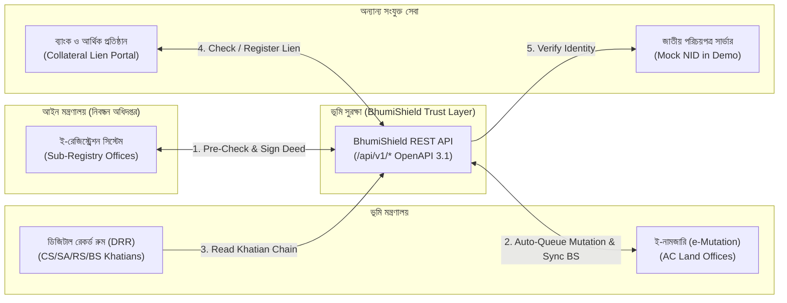

# ইন্টিগ্রেশন গাইড — বিদ্যমান সরকারি সিস্টেমে সংযোগ (Integration Story)

**ভূমি সুরক্ষা (BhumiShield)** এমনভাবে ডিজাইন করা হয়েছে যাতে বাংলাদেশের বিদ্যমান ভূমি ও নিবন্ধন অবকাঠামোয় কোনো বড় পরিবর্তন ছাড়াই একটি **API Gateway / Middleware Trust Layer** হিসেবে যুক্ত হতে পারে।

## ১. কোন সরকারি সিস্টেমের সাথে কীভাবে যুক্ত হবে?

## ২. হ্যাকাথন প্রোটোটাইপ বনাম বাস্তব প্রোডাকশন ডিপ্লয়মেন্ট

হ্যাকাথনের নিয়মাবলী কঠোরভাবে মেনে এই প্রোটোটাইপে **কোনো সরকারি ওয়েবসাইট স্ক্র্যাপ করা হয়নি এবং কোনো লাইভ সরকারি সার্ভারে কল করা হয়নি**। বাস্তব প্রোডাকশনে নিচের মক সার্ভিসগুলো সরকারি গেটওয়ে দ্বারা প্রতিস্থাপিত হবে:

| মডিউল | হ্যাকাথন ডেমো প্রোটোটাইপে যা আছে | বাস্তব সরকারি ইন্টিগ্রেশনে যা যুক্ত হবে |
| :--- | :--- | :--- |
| **জাতীয় পরিচয়পত্র যাচাই (NID)** | `backend/app/rules/mock_nid.py` (৪২ জন কাল্পনিক নাগরিকের মক এনআইডি রেজিস্ট্রি `9900001001`–`9900001042`) | নির্বাচন কমিশনের (EC) জাতীয় পরিচয়পত্র যাচাই গেটওয়ে / পরিচয় (Porichoy) API |
| **খতিয়ান রেকর্ড (CS/SA/RS/BS)** | `khatian_records` ও `ownerships` টেবিল (৩টি মৌজায় ৬০টি দাগের ২৪০টি সিডেড খতিয়ান) | ভূমি মন্ত্রণালয়ের ডিজিটাল রেকর্ড রুম (DRR) ও ই-পর্চা (e-Porcha) API |
| **ই-নামজারি সিঙ্ক (e-Mutation)** | `POST /api/v1/mutations/{id}/decide` (এসি ল্যান্ড ড্যাশবোর্ড) | ভূমি মন্ত্রণালয়ের ই-নামজারি সিস্টেমের ওয়েবহুক (Webhook) |
| **সাব-রেজিস্ট্রার ডিজিটাল স্বাক্ষর** | এনভায়রনমেন্ট ভেরিয়েবল থেকে লোড করা ডেমো `Ed25519` প্রাইভেট কি | বিসিসি (BCC) অনুমোদিত হার্ডওয়্যার সিকিউরিটি মডিউল (HSM) / ডংগল |

## ৩. ওপেনএপিআই স্পেসিফিকেশন (OpenAPI 3.1 Spec)

FastAPI স্বয়ংক্রিয়ভাবে সম্পূর্ণ ইন্টারেক্টিভ OpenAPI 3.1 ডকুমেন্টেশন প্রকাশ করে:
- **Swagger UI:** `http://localhost:8000/docs`
- **ReDoc:** `http://localhost:8000/redoc`
- **Raw OpenAPI JSON:** `http://localhost:8000/openapi.json`

*(যদি ভবিষ্যতে ব্যাকএন্ড Laravel বা অন্য কোনো ফ্রেমওয়ার্কে রূপান্তর করা হয়, এই একই `/api/v1/*` JSON কন্ট্রাক্ট অপরিবর্তিত থাকবে।)*

## ৪. ইউনিয়ন ডিজিটাল সেন্টার ও স্বল্প-ব্যান্ডউইথ / অফলাইন সাপোর্ট (Union Office Low-Connectivity Note)

গ্রামীণ ইউনিয়ন ভূমি অফিস ও নাগরিকদের ধীরগতির মোবাইল ইন্টারনেটের কথা মাথায় রেখে:
1. **হালকা বান্ডেল ও জিরো হেভি মিডিয়া:** কোনো ভারী ছবি বা ভিডিও ব্যবহার করা হয়নি; সকল আইকন ও ৩-ধাপের নির্দেশিকা ইনলাইন SVG দিয়ে তৈরি।
2. **প্রোগ্রেসিভ ওয়েব অ্যাপ (PWA App Shell):** `frontend/public/manifest.json` এবং সার্ভিস ওয়ার্কার (`frontend/public/sw.js`) অ্যাপ শেল ও ফন্ট অফলাইনে ক্যাশ করে রাখে।
3. **অফলাইন ব্যানার (`অফলাইন মোড`):** ইন্টারনেট সংযোগ বিচ্ছিন্ন হলে স্বয়ংক্রিয়ভাবে উপরে হলুদ সতর্কবার্তা দেখায় এবং পূর্বে লোড করা রিপোর্ট প্রিন্ট বা দেখার সুযোগ দেয়।
