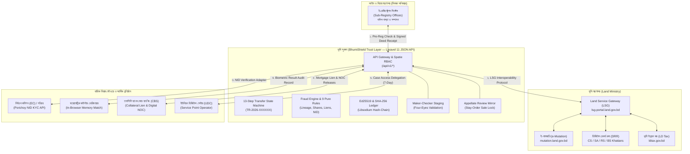

# ইন্টিগ্রেশন আর্কিটেকচার ও সরকারি গেটওয়ে অ্যাডাপ্টার — ভূমি সুরক্ষা (BhumiShield v2)

**ভূমি সুরক্ষা (BhumiShield)** এমনভাবে ডিজাইন করা হয়েছে যাতে বাংলাদেশের বিদ্যমান ভূমি ও নিবন্ধন অবকাঠামোয় কোনো বড় পরিবর্তন ছাড়াই একটি **API Gateway / Interoperable Trust Layer** হিসেবে যুক্ত হতে পারে। এটি কোনো বিদ্যমান সরকারি পোর্টাল প্রতিস্থাপন করে না; বরং তাদের মধ্যে রিয়েল-টাইম ডেটা সমন্বয় এবং ক্রিপ্টোগ্রাফিক অখণ্ডতা নিশ্চিত করে।

---

## ১. সরকারি ইকোসিস্টেমে সংযোগ চিত্র (Interoperability Topology)



---

## ২. নির্বাচন কমিশন (EC) ও ‘পরিচয়’ (Porichoy) NID অ্যাডাপ্টার স্পেসিফিকেশন

### ২.১ আর্কিটেকচার নীতি
- হ্যাকাথন ডেমোতে কোনো লাইভ সরকারি সিস্টেমে রিকোয়েস্ট পাঠানো হয় না। `App\Services\LookupService` এবং `App\Services\PublicRecordService` ডেমো টেস্ট NID-র একটি সম্পূর্ণ সিন্থেটিক রেজিস্ট্রি পরিচালনা করে (`9900001001` থেকে `9900004002`)।
- প্রোডাকশনে এই ইন্টারফেসটি সরাসরি **পরিচয় (Porichoy)** গেটওয়ের সাথে সংযুক্ত হবে।

### ২.২ রিকোয়েস্ট ও রেসপন্স কন্ট্রাক্ট (REST JSON)

```http
POST /api/v1/adapters/nid/verify
Authorization: Bearer <GOVT_INTEGRATION_TOKEN>
Content-Type: application/json

{
  "nid": "9900001001",
  "dob": "1980-05-12",
  "name_bn": "মো. রফিকুল ইসলাম",
  "face_probe_present": true
}
```

**সফল রেসপন্স (200 OK):**
```json
{
  "status": "MATCHED",
  "transaction_id": "PORICHOY-2026-883921",
  "verification_score": 98.4,
  "identity": {
    "nid_masked": "9900****01",
    "full_name_bn": "মো. রফিকুল ইসলাম",
    "full_name_en": "Md. Rafiqul Islam",
    "status": "ACTIVE_VOTER"
  },
  "verified_at": "2026-10-17T04:20:00Z"
}
```

---

## ৩. ল্যান্ড সার্ভিস গেটওয়ে (LSG Adapter — `lsg-portal.land.gov.bd`)

ভূমি সুরক্ষা ভূমি মন্ত্রণালয়ের **ল্যান্ড সার্ভিস গেটওয়ে (LSG)**-এর সাথে দ্বি-মুখী সংযোগ রক্ষা করে:

1. **ই-নামজারি স্বয়ংক্রিয় কিউ (e-Mutation Dispatch):**
   - সাব-রেজিস্ট্রার অফিসে দলিল স্বাক্ষরিত হওয়ার সাথে সাথে BhumiShield স্বয়ংক্রিয়ভাবে `ApproveMutation` কিউতে কেস পাঠায়।
   - ওয়েবহুক পে-লোডে থাকে: `transfer_code`, `deed_hash`, `dag_no`, `mouza`, `seller_nid`, `buyer_nid`, এবং `area_decimal`।
2. **ডিজিটাল রেকর্ড রুম (DRR Khatian Lineage):**
   - সিএস (CS) → এসএ (SA) → আরএস (RS) → বিএস (BS) খতিয়ান চেইনের হিস্যা ও ধারাবাহিকতা রিড-ওনলি মোডে ক্যাশ করে।
   - খতিয়ানের মোট জমি ও যৌথ অংশীদারদের হিস্যা যোগফল (১.০০০ বা ১৬ আনা) স্বয়ংক্রিয়ভাবে পরীক্ষা করে।
3. **অনবোর্ডিং খতিয়ান সমন্বয় (Khatian Reconciliation):**
   - পুরোনো এনালগ বালাম বই থেকে ডিজিটালাইজেশনের সময় মেকার-চেকার ব্যাচ প্রুফ প্যাকেজ তৈরি করে ড্রাফট রেকর্ডকে স্ট্যাজিং ডেটাতে রাখে।

---

## ৪. বায়োমেট্রিক প্রোভাইডার আর্কিটেকচার (Biometric Verification Interface)

### ৪.১ হ্যাকাথন ও আইনি নিরাপত্তা নীতি (Strict Zero-Storage Rule)
> **[গুরুত্বপূর্ণ নীতি]:**  
> হ্যাকাথনের নির্দেশিকা ও বাংলাদেশ তথ্য নিরাপত্তা আইন অনুসারে, **ভূমি সুরক্ষার ব্রাউজার বা সার্ভার ডাটাবেজে কখনোই কোনো নাগরিকের চেহারা বা আঙুলের ছাপের বায়োমেট্রিক টেমপ্লেট সংরক্ষিত হয় না**।
> ক্যামেরা ফ্রেম ব্রাউজারের ক্ষণস্থায়ী মেমরিতে লাইভনেস ও এনআইডি চিপ বা পরিচয় ভেরিফায়ারে ম্যাচ হয়।

### ৪.২ সংরক্ষিত অডিট রেকর্ড (Audit Record Structure)
সার্ভারে শুধুমাত্র যাচাইয়ের আইনি ট্রানজ্যাকশন ফলাফল রেকর্ড করা হয়:
- `transaction_id`: যেমন `BIO-2026-X9A21F`
- `party_role`: `SELLER` বা `BUYER`
- `party_nid_masked`: যেমন `9900****01`
- `match_yes_no`: `true`
- `confidence_score`: যেমন `97.8%`
- `terminal_id`: সাব-রেজিস্ট্রি অফিসের কাউন্টার টার্মিনাল আইডি
- `officer_id`: দায়িত্বরত কর্মকর্তার আইডি
- `timestamp`: আইএসও ৮৬০১ সময়

---

## ৫. মেকার-চেকার স্ট্যাজিং অনবোর্ডিং (Section 8.7)

ডিজিটালাইজেশন ও রেকর্ড সমন্বয় কার্যক্রমে জালিয়াতি রোধে **চার-চোখের নীতি (Four-Eyes Principle)** কার্যকর:
1. **মেকার (Maker):** ইউনিয়ন ভূমি সহকারী কর্মকর্তা, রেজিস্ট্রি ডাটা অফিসার বা সেটেলমেন্ট রেকর্ডস অফিসার ড্রাফট ব্যাচ তৈরি করেন (`ONB-2026-XXXX`)। প্রতিটি আইটেমের ক্যানোনিকাল পে-লোড দিয়ে `SHA-256` ব্যাচ হ্যাশ সিল প্রস্তুত হয়।
2. **চেকার (Checker):** সাব-রেজিস্ট্রার, সহকারী সেটেলমেন্ট অফিসার বা এসি ল্যান্ড ব্যাচের প্রতিটি আইটেমের বৈধতা ও হ্যাশ অখণ্ডতা যাচাই করে অনুমোদন (`APPROVED`) বা সংশোধন নির্দেশ (`REJECTED`) দেন।
3. **আইনি বাধা:** মেকার কখনোই নিজের ব্যাচ অনুমোদন করতে পারেন না (`SEPARATION_OF_DUTIES_VIOLATION` ৪০৩ এরর)।

---

## ৬. আপিল ট্রাইব্যুনাল ও লিগ্যাল স্ট্যাটাস মিরর (Section 8.8)

নামজারি আদেশ বা নামঞ্জুরের বিরুদ্ধে আইনি প্রতিকার:
- অতিরিক্ত জেলা প্রশাসক (রাজস্ব) বা ইউএনও ট্রাইব্যুনালে আপিল দায়ের (`APL-2026-XXXX`)।
- শুনানি নির্ধারণ (`HEARING_SCHEDULED`)।
- **স্থগিতাদেশ (Stay Order Granted):** আপিল আদালত স্থগিতাদেশ প্রদান করার সাথে সাথে BhumiShield সিস্টেমে সংশ্লিষ্ট দাগের `owner_sale_locked = 1` সেট হয়ে যায়। ফলে নিষ্পত্তি না হওয়া পর্যন্ত কোনো সাব-রেজিস্ট্রার ওই দাগে নতুন দলিল রেজিস্ট্রি করতে পারেন না এবং এসি ল্যান্ড কোনো নামজারি অনুমোদন করতে পারেন না।

---

## ৭. ইউনিয়ন ডিজিটাল সেন্টার ও অফলাইন PWA সাপোর্ট

গ্রামীণ এলাকায় নিরবচ্ছিন্ন ভূমি সেবা নিশ্চিত করতে:
1. **PWA App Shell ও অফলাইন ক্যাশিং:** সার্ভিস ওয়ার্কার কোর ইন্টারফেস ও ফন্ট ক্যাশ করে রাখে; দুর্বল নেটওয়ার্কেও আবেদন ফরম ওপেন থাকে।
2. **সার্ভিস পয়েন্ট অপারেটর (SPO) এক্সেস ডেলিগেশন:** ইউডিসি উদ্যোক্তারা নির্দিষ্ট আবেদন বা দলিলের জন্য ৭ দিনের টাইম-বাউন্ড এক্সেস গ্রান্ট পান (`case_access_grants`)।
3. **স্বল্প ব্যান্ডউইথ বান্ধব:** কোনো ভারী বহিরাগত লাইব্রেরি বা ভারী ছবি নেই; সম্পূর্ণ ইন্টারফেস লাইটওয়েট SVG ও টেলউইন্ড ভিত্তিক।
